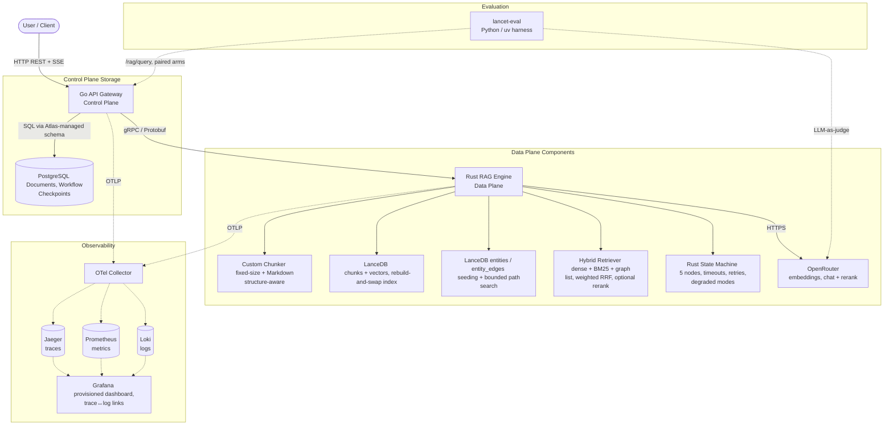

# Lancet 🚀

> [!NOTE]
> **v1 complete (2026-10-11).** Lancet's v1 is built, measured on held-out data, and documented, with a quickstart verified from a fresh clone on Windows and on WSL. The results are in [`docs/evaluation.md`](docs/evaluation.md), and the phase-by-phase record of how it was built is in [`docs/build-history.md`](docs/build-history.md). The [v1 milestone summary](.planning/phases/06.4-docs-suite-verified-quickstart-debt-backlog-promotion-and-v1/06.4-MILESTONE-SUMMARY.md) lists what shipped and what is carried forward.

**Lancet** is an end-to-end, systems-oriented Retrieval-Augmented Generation (RAG) and GraphRAG platform. It is built to show data-plane engineering depth and evaluation discipline: a Go control plane and a Rust data plane joined by gRPC, custom chunking, hybrid dense + BM25 retrieval over embedded LanceDB with an optional rerank step and an opt-in knowledge graph, a lightweight Rust state machine with degraded modes, production-style observability, and a benchmark harness whose results can be believed — including when they are negative.

## 📊 What v1 found

**The two standard levers that now ship as defaults measurably helped on held-out data: reranking added about +8 points to `answer_usable` and about +16 points to Hits@4, and evidence metadata added about +6 points, all three Holm-significant ([results](docs/evaluation.md#defaults-that-shipped)). Reranking is not free: it adds latency to every default request, and when the rerank provider is in its slow mode a request can pay up to the 2,286 ms rerank budget ([the caveat](docs/evaluation.md#defaults-that-shipped)).** The knowledge graph is the honest other half. It is built and observable, and it costs latency and prompt tokens, but it bought no significant gain, and neither did graph-v2, the repair a per-question diagnosis chose ([graph cost](docs/evaluation.md#graph-cost-reconciled)). So the graph ships off, and a request turns it on with `"disable_graph_context": false`.

| Lever | Effect on held-out | Significant? | Cost |
|---|---|---|---|
| rerank (default on) | about +8 points `answer_usable`, about +16 points Hits@4 ([results](docs/evaluation.md#defaults-that-shipped)) | yes | a paid rerank call per request: +289 ms mean total latency and +458 ms of retrieval time, up to the 2,286 ms budget in the provider's slow mode ([results](docs/evaluation.md#defaults-that-shipped)) |
| evidence_metadata (default on) | about +6 points `answer_usable` ([results](docs/evaluation.md#defaults-that-shipped)) | yes | +471 prompt tokens, no latency change ([results](docs/evaluation.md#lever-run-seven-arms)) |
| graph, v1 (opt-in) | -0.0101 `answer_usable`, -0.0101 Hits@4 ([results](docs/evaluation.md#baseline-run-four-retrieval-arms)) | no | +198.9 prompt tokens and +15.9020 ms of retrieval time per request ([results](docs/evaluation.md#graph-cost-reconciled)) |
| graph-v2 (off) | -0.0195 `answer_usable`, -0.0130 Hits@4 ([results](docs/evaluation.md#lever-run-seven-arms)) | no | the graph's own cost, since it runs the graph ([results](docs/evaluation.md#lever-run-seven-arms)) |
| answer-format (off) | -0.0423 `answer_usable`, on the harmful side ([results](docs/evaluation.md#lever-run-seven-arms)) | no | a longer prompt: 2340 against 2255 mean prompt tokens ([results](docs/evaluation.md#lever-run-seven-arms)) |

"Points" are the owner's plain-language reading of the stored deltas, which are fractions of 1, so one point is a hundredth. The other effects are quoted as stored. Each effect is a paired comparison against plain `hybrid` retrieval on the same day's run. The full tables, with sample sizes, intervals and gate readings, are on the [results page](docs/evaluation.md).

---

## 📖 The Story & Motivation

Most RAG applications are built on high-level orchestration frameworks and pre-packaged API wrappers. That is convenient, and it hides the data-plane complexity, the database access patterns and the performance characteristics that decide whether a system holds up.

Lancet builds the core data plane from scratch instead: custom chunkers, index lifecycle, hybrid retrieval and fusion, graph seeding and path search, prompt assembly and a state-machine orchestrator in **Rust**, behind a lightweight **Go** gateway, with **gRPC/Protobuf** as the boundary. Mature tools are used where they are commodity — PostgreSQL, LanceDB, OpenTelemetry, Jaeger, Prometheus, Loki, Grafana, OpenRouter — and rebuilt where building them demonstrates understanding.

The second half of the project is the way it was built. Every plan was planned and executed with an AI-agent-assisted workflow (the GSD methodology, run with Claude Code), and the trail is under [`.planning/`](.planning): the phases carry their PLAN, SUMMARY, VERIFICATION, code review, security audit and UAT records. This is human-directed collaboration, not autonomous authorship. The human part is directing, reviewing, holding the agent to explicit verification gates, and making the calls it cannot make. Two kinds of call stand out:

- **Force-closing on schedule with a debt ledger.** [ADR-02-004](.discussion/decisions/phases/02/2026-07-30-ADR-02-004-all-the-way-to-ship-mvp.md) and [ADR-03-003](.discussion/decisions/phases/03/2026-08-05-ADR-03-003-all-the-way-to-ship-mvp.md) closed Phases 2 and 3 with their remaining gaps named as `DEBT-*` items and carried forward, rather than letting them block progress or silently drop. Phases 6 and 6.1 then paid most of that debt down, and Phase 6.4 promoted the rest to themed backlog phases.
- **Refusing a result that looked good.** The first full benchmark run (2026-09-03) reported 1,000 successful queries and a positive graph effect. The harness's own provenance checks showed that 966 of the 1,000 answers were empty, 904 queries had been clipped at a retrieval timeout, and the ablation delta had been computed over two arms that shared 1.6% of their questions. That finding spawned the 06.3.1–06.3.4.1 family: fail-closed reporting, paired per-question ablation, censoring-aware latency measurement and derived timeout budgets, pre-registered gates committed before each paid drive, and a graph-retrieval redesign. Two more phases then measured standard baselines and quality levers on a held-out split. The result is three runs of record whose numbers are modest and trustworthy. The forensic trail is [`06.3.1-ROOT-CAUSE.md`](.planning/phases/06.3.1-fix-retrieval-citation-collapse-and-graph-ablation-measureme/06.3.1-ROOT-CAUSE.md), the public note is [`docs/evaluation-fidelity-and-graph-yield.md`](docs/evaluation-fidelity-and-graph-yield.md), and the history is told once on the [results page](docs/evaluation.md#history).

### How it was built

250 plans across 18 phases, from the first ping to the v1 docs. One line per group; the full per-phase list is in [`docs/build-history.md`](docs/build-history.md).

- **Phase 1 (1 plan, 2026-07-13).** The Go gateway, the Rust engine and the gRPC contract, pinging each other.
- **Phases 2 and 3 (51 plans, to 2026-08-05).** Ingestion, chunking, LanceDB storage, hybrid retrieval and the first answer path, both force-closed with a named debt ledger.
- **Phase 4 and Phase 04.1 (10 plans, to 2026-08-09).** A `lance-graph` compatibility spike, then entity and relation extraction and graph query.
- **Phase 5 (27 plans, to 2026-08-19).** The Rust state machine and typed workflow events streamed over SSE.
- **Phases 6, 6.1 and 6.2 (32 plans, to 2026-08-27).** The consolidated wire contract and degraded modes, index rebuild-and-swap, and OpenTelemetry end to end.
- **Phase 6.3 and Phases 06.3.1 to 06.3.4.1 (71 plans, to 2026-10-06).** The evaluation harness, the refused first run, and the work that made the evaluation signal trustworthy, ending with a repaired graph path.
- **Phases 06.3.5 and 06.3.6 (41 plans, to 2026-10-11).** Four retrieval baselines, then four quality levers measured as arms on held-out data, with defaults chosen by a pre-registered rule.
- **Phase 6.4 (17 plans, 2026-10-11).** A small code-first slice (the default-lever opt-out, the graph default-off, harness preflight checks), this README, the four `docs/` pages, the verified quickstart and the v1 closure.

---

## 🎯 Architecture



**The default request.** A request that sets nothing runs hybrid retrieval with the `rerank` and `evidence_metadata` levers and no graph: graph context is opt-in per request with `"disable_graph_context": false` (D-207). Those two levers were each measured against plain hybrid, but never together as one arm; the results page carries that [interaction caveat](docs/evaluation.md#defaults-that-shipped).

### What is built

1. **Go API Gateway (control plane, [`gateway/`](./gateway)).** HTTP REST server with document upload and ingestion, the `/rag/query` endpoint streaming workflow events over SSE (graph context is served inside it; the engine's standalone `QueryGraph` RPC stays gRPC-only, Phase 4 D-25), session IDs that the engine issues and the gateway echoes in `X-Lancet-Session-ID` (no session table), PostgreSQL persistence for documents and workflow checkpoints (Atlas-managed schema, separate `local` and `eval` environments), graceful shutdown that drains buffered checkpoints, and an OTel pipeline with a rate-limited exporter error handler. The listener binds to loopback only (see [Local-only constraint](#-local-only-exposure-constraint--debt-triggers-debt-cr-04)).
2. **Rust RAG Engine (data plane, [`engine/`](./engine)).** An asynchronous gRPC server implementing:
   - **Ingestion and chunking.** Markdown, plain text and JSON sources; fixed-size and Markdown structure-aware chunkers; embeddings via OpenRouter; document metadata (title, source, published date); staged writes with an index **rebuild-and-swap** lifecycle and cross-index corpus generation so a query never reads a half-built index.
   - **Hybrid retrieval.** Embedded LanceDB dense search, a local BM25 lexical index, metadata filtering, deduplication and deterministic weighted Reciprocal Rank Fusion with documented tie rules; multi-variant reformulation fusion; a per-request retrieval mode (`hybrid`, `dense_only`, `bm25_only`); and a reranker port that the `rerank` lever fills with an OpenRouter rerank model, keeping the fused order if the call fails.
   - **Quality levers.** Four levers a request can name: `rerank`, `evidence_metadata` (title, source and date headers on each evidence block), `binary_answer_format` and `graph_v2`. The snapshot echoes the levers that actually ran. The first two are the configured defaults, and a default the engine cannot serve is dropped with a notice rather than silently claimed.
   - **GraphRAG.** Entity and relation extraction at ingestion into `entities` / `entity_edges` LanceDB tables; at query time, model-free mention extraction, seed matching (exact name, normalised name, then name-vector nearest neighbour), bounded seed-to-seed one- and two-hop path search with a degree cap derived from the store's p99, path facts injected into the prompt under a token-budget-derived cap, and the path entities' source chunks fused as a third RRF list. Cypher-style pattern queries via `lance-graph` for the graph API. Off by default, on per request.
   - **Orchestration.** A five-node state machine (reformulate → extract graph context → retrieve hybrid → assemble prompt → generate answer; graph context runs before retrieval because its node also computes the query embedding) with per-node timeouts derived from measured p95s, retries, cancellation, PostgreSQL-backed checkpoints with strict FIFO drain, and typed client-facing events.
   - **Degraded modes as contract, not accident.** Every fallback is a typed notice on the wire: `NO_EVIDENCE`, `GRAPH_TIMEOUT`, `GRAPH_DEGRADED`, `GRAPH_UNAVAILABLE`, `RETRIEVAL_DEGRADED_DENSE`, `RETRIEVAL_FAILED`, `CITATION_REPAIRED`, `CITATION_DROPPED`, `MODEL_ONLY`, `BASIS_RECONCILED`, `GRAPH_ABLATION`, `INDEX_REBUILD_FAILED`, `RERANK_DEGRADED`, `DEFAULT_LEVER_UNAVAILABLE` and `GRAPH_DISABLED_BY_CONFIG`, among others; [`docs/api-contract.md`](docs/api-contract.md) lists every code and whether it sets `degraded_mode`. Model-only answers are opt-in and fail closed by default. Citation repair never ships an excerpt the model did not see.
3. **gRPC contract ([`proto/`](./proto)).** The Protobuf boundary between the two services, including the per-request graph, retrieval-mode and lever fields the evaluation harness uses. The request fields, refusals and notice codes are published as API contract in [`docs/api-contract.md`](docs/api-contract.md).
4. **Observability ([`deploy/`](./deploy), `docker-compose.yml`).** OpenTelemetry traces, metrics and structured logs from both services through an OTel Collector to Jaeger, Prometheus and Loki, with a provisioned Grafana dashboard (`histogram_quantile` latency panels, trace-to-log correlation via `trace_id`). Every node is a span, with leaf spans for each external call, the rerank call included. Ingestion is traced end to end through chunking, embedding, graph extraction and index swap.
5. **Evaluation harness ([`eval/`](./eval), `lancet-eval`).** A `uv`-managed Python package that drives the gateway as a black box over the MultiHop-RAG benchmark. Each question runs through several arms (retrieval baselines, graph on and off, and one arm per lever), each compared per question against plain `hybrid`. The harness journals every attempt with provenance, computes deterministic retrieval and answer metrics without an LLM, applies exact paired tests with Holm correction against pre-registered gates, runs cached LLM-as-judge groundedness and faithfulness scoring with a human calibration path, enforces per-stage spend caps reconciled against the provider account, and refuses to publish an incomplete journal as complete. A preflight checks, per arm, that the engine echoes the graph and lever settings the arm declares. Isolated from the dev stack by a separate LanceDB path and PostgreSQL schema.

Tests: 963 Rust and 124 Go test functions (the counts the local gate scripts pin) and 2,357 Python tests, all runnable offline except the explicitly live-evidence suites.

---

## 📚 Documentation

The README is the front door; the deep-dives are in [`docs/`](docs):

* [`docs/design-narrative.md`](docs/design-narrative.md) — the alternatives considered and why each was rejected: the state machine, LanceDB, chunking, the two-language split, the evaluation design, the graph shipping off, and levers measured as arms.
* [`docs/observability.md`](docs/observability.md) — one question followed through two real Jaeger traces, the default request and the same question with the graph opted in, then the metrics, logs and sampling.
* [`docs/evaluation.md`](docs/evaluation.md) — the methodology and the three runs of record, quoted verbatim, with a paired-delta forest plot, the defaults that shipped and the graph cost reconciled across runs.
* [`docs/api-contract.md`](docs/api-contract.md) — the request fields, refusals and every notice code, pinned to the proto by a test.
* [`docs/build-history.md`](docs/build-history.md) — every phase, with its plan count and date.
* [`docs/evaluation-fidelity-and-graph-yield.md`](docs/evaluation-fidelity-and-graph-yield.md) — the operational note on the refused first run and the graph-yield repair.

---

<!-- quickstart:start -->
## 🚀 Quickstart (Windows native and Linux via WSL)

> Verified on a fresh clone: Windows 11 native on 2026-10-11 at commit 1c000271 (06.4-QS-TRANSCRIPT-WINDOWS.md); WSL Ubuntu 24.04 on 2026-10-11 at commit 752c8ae0 (06.4-QS-TRANSCRIPT-WSL.md).

This takes a clean clone to a traced answer over a five-document sample, on Windows native and on Linux inside WSL. Both platforms run the same commands; where a shell differs, both variants are shown. Run every command from the repository root unless a step says otherwise. The only thing you supply is an OpenRouter API key.

### Prerequisites

| Need | Windows (PowerShell) | WSL Ubuntu 24.04 |
|---|---|---|
| Docker | Docker Desktop | Docker Desktop with WSL integration enabled |
| Rust | cargo 1.95 | cargo 1.95 |
| `protoc` | on `PATH` | `protobuf-compiler` (below) |
| Go | 1.25 or later | 1.26.5 official tarball (below) |
| Atlas | on `PATH` | official installer (below) |
| uv | on `PATH` | `~/.local/bin/uv` |
| Git | on `PATH` | on `PATH` |
| Chrome and Node 22+ | only for the optional screenshot scripts | not needed |

On WSL, install the system packages, the pinned Go toolchain and Atlas once. Any Go 1.25 or later works; 1.26.5 is the toolchain the Windows run uses.

```bash
sudo apt-get install -y pkg-config libssl-dev protobuf-compiler
curl -fsSLo /tmp/go1.26.5.linux-amd64.tar.gz https://go.dev/dl/go1.26.5.linux-amd64.tar.gz
sudo rm -rf /usr/local/go
sudo tar -C /usr/local -xzf /tmp/go1.26.5.linux-amd64.tar.gz
curl -sSf https://atlasgo.sh | sh
```

A non-login WSL shell does not have uv, cargo or Go on its `PATH`, so add them in every terminal:

```bash
export PATH="$HOME/.local/bin:$HOME/.cargo/bin:/usr/local/go/bin:$PATH"
```

### Steps

**1. Clone.** It must be a full clone: never use `--depth`. The offline re-score in step 13 checks git history (a pre-registration commit has to be older than the run it scores), and a shallow clone makes `score` refuse. `git fetch --unshallow` repairs a shallow one.

```bash
git clone https://github.com/mileschintw/rust-lancedb-graphrag.git lancet-qs
cd lancet-qs
```

The compose commands below all pass `-p lancet-qs`, so the quickstart never shares volumes with a dev stack you already run. Container names and loopback ports are fixed, though, so stop a running Lancet dev stack first (`docker compose -p lancet down`, without `-v`).

**2. Set the key and export `.env`.** `.env.example` holds an empty `OPENROUTER_API_KEY=`; copy it to `.env`, fill in the key and export the file into the current shell. Nothing loads `.env` by itself, and `.env` is gitignored. Every new terminal repeats the export.

```bash
cp .env.example .env
# edit .env and set OPENROUTER_API_KEY
set -a; . ./.env; set +a
```

```powershell
Copy-Item .env.example .env
# edit .env and set OPENROUTER_API_KEY
Get-Content .env | % { if ($_ -match '^\s*([^#=\s]+)\s*=\s*(.*)$') { Set-Item "env:$($Matches[1])" $Matches[2].Trim('"') } }
$env:PYTHONUTF8 = "1"
```

The last PowerShell line makes Windows Python read text as UTF-8 instead of the system codepage (cp950 on one machine this was tried on); without it, scores do not match across platforms. The Postgres (`postgres`/`postgres`) and Grafana (`admin`/`admin`) logins used below are committed local-dev credentials, not secrets.

**3. Start the infrastructure.**

```bash
docker compose -p lancet-qs --profile observability up -d
```

The `observability` profile is what starts Jaeger, Prometheus, Loki, the OpenTelemetry collector and Grafana. Without it only Postgres starts.

**4. Apply the database schema.**

```bash
cd gateway
atlas schema apply --env local --auto-approve
cd ..
```

**5. Config.** `config/config.toml` is tracked and carries the shipped defaults, so nothing is copied over it.

**6. Start the engine** in its own terminal (repeat the step 2 export there). The first build takes about 20 minutes on a cold clone. The engine crate holds several binaries, so `--bin engine` names the one to run.

```bash
cargo run --manifest-path engine/Cargo.toml --release --bin engine
```

The engine also logs many `lance::` dataset lines. Filtered, a start over the empty store prints these, in this order (`build_ms` varies):

```
 INFO engine: telemetry_mode telemetry_mode="otlp" endpoint=http://127.0.0.1:4317
 INFO engine: BM25 snapshot built document_count=0 generation=lance-1 nodes_version=1 graph_entities=0 doc_meta_documents=0
 WARN engine: configured default lever is unavailable: a request that names no lever runs without it and carries a DEFAULT_LEVER_UNAVAILABLE notice; apply the remedy or set [engine.levers] defaults = [] to start lever-free lever="evidence_metadata" reason="the corpus snapshot holds no document metadata" remedy="ingest documents with doc_title, source or published_date, or run `backfill_evidence_metadata`; a legacy 19-column store runs `--migrate-only` first"
 INFO engine: Prompt tokenizer ready tokenizer="cl100k_base" build_ms=224.369 sample_tokens=10
 INFO engine: Staged ingestion jobs replayed replayed_jobs=0
 INFO engine: Rust RAG Engine serving addr=127.0.0.1:50051 build_profile="release" log_filter=info,engine=debug
```

The WARN is expected: the committed defaults want document metadata and the store has none yet.

**7. Start the gateway** in a second terminal (repeat the step 2 export there). The Go module lives in `gateway/`, so run it from that directory.

```bash
cd gateway
go run .
```

**8. Check health.** In PowerShell use `curl.exe`; plain `curl` is an alias for `Invoke-WebRequest`.

```bash
curl http://127.0.0.1:8080/health
```

```powershell
curl.exe http://127.0.0.1:8080/health
```

**9. Query before ingesting anything.** `quickstart.py` is a small helper so PowerShell and bash run identical commands. It sends a W3C `traceparent` header and prints the trace id.

```bash
uv run --project eval python eval/scripts/quickstart.py query "Who directs Harbor Light Observatory?"
```

The store is empty, so the printed JSON shows `"degraded_mode": true`, a `notice_codes` list that includes 24 and 25, a `notices` list that includes `DEFAULT_LEVER_UNAVAILABLE` and `GRAPH_DISABLED_BY_CONFIG`, and `"levers": ["rerank"]`. Other notices can appear beside those two; those are the ones to look for. This is the shipped behaviour of a store without document metadata (see below), not a fault.

**10. Ingest the sample.** The five documents in `eval/corpora/quickstart/` are project-authored fiction under this repository's MIT license, each posted with a `doc_title`, a `source` and a `published_date`.

```bash
uv run --project eval python eval/scripts/quickstart.py ingest
```

It prints one JSON line per document and exits non-zero if a document fails or the 420-second deadline expires. Then wait until the engine terminal shows a line containing `evidence_metadata became available again` and a line containing `index.swap.metadata_coverage: documents_with_metadata=5 documents=5` (a 2-second debounce plus the index rebuild). Coverage lines with smaller counts can appear while the five documents finish; the 5-of-5 line is the one to wait for.

**11. Query again, then ask the two-hop question.** Re-run the step 9 query: the printed JSON no longer lists `DEFAULT_LEVER_UNAVAILABLE`, and `levers` is now `["rerank", "evidence_metadata"]`. Then ask a question that names two linked entities (the Alder Optics profile alone names the builder and where it is based, and the observatory overview confirms that Marisol Vega directs Harbor Light Observatory), first with the defaults and then with the graph opted in:

```bash
uv run --project eval python eval/scripts/quickstart.py query "Which company built the spectrograph at Harbor Light Observatory, which Marisol Vega directs, and where is that company based?"
uv run --project eval python eval/scripts/quickstart.py query "Which company built the spectrograph at Harbor Light Observatory, which Marisol Vega directs, and where is that company based?" --graph
```

The expected answer is Alder Optics, based in Port Marlow. The question names two entities, Harbor Light Observatory and Marisol Vega, because the graph looks for a path between entities the question names; a question that names only one cannot produce a path. `graph_path_found` says whether the graph found a path between the question's entities; it only means something with `--graph`, and whether entity extraction links the documents is not guaranteed on a five-document sample.

**12. Open the traces and dashboard.** In Jaeger, <http://127.0.0.1:16686>, pick the service `lancet-gateway` and paste the printed `trace_id` (or open `http://127.0.0.1:16686/trace/<trace_id>` directly). Grafana is at <http://127.0.0.1:3000>, dashboard "Lancet RAG Operations", login `admin`/`admin` (a committed local-dev credential).

**13. Re-score a recorded run offline.** This is free and needs no key. It scores a temporary copy of the 06.3.6 run of record's journal and compares the result with the committed report, so nothing under `eval/runs/` is written.

```bash
RUN=eval/runs/2026-10-10-levers-heldout-multihop_rag_levers_heldout
TMP=$(mktemp -d) && cp "$RUN/journal.jsonl" "$TMP/"
uv run --project eval lancet-eval score --run "$TMP" --no-judge
uv run --project eval lancet-eval report --run "$TMP"
uv run --project eval python eval/scripts/compare_rescore.py "$RUN" "$TMP"
git status --porcelain -- eval/runs
```

```powershell
$run = "eval/runs/2026-10-10-levers-heldout-multihop_rag_levers_heldout"
$tmp = New-Item -ItemType Directory -Path (Join-Path $env:TEMP "lancet-rescore-$(Get-Random)")
Copy-Item "$run/journal.jsonl" $tmp
uv run --project eval lancet-eval score --run $tmp --no-judge
uv run --project eval lancet-eval report --run $tmp
uv run --project eval python eval/scripts/compare_rescore.py $run $tmp
git status --porcelain -- eval/runs
```

`score` takes about 3 minutes. The re-score reproduces the run when every scored dimension and the `result_hash` are equal; `compare_rescore.py` checks that and exits non-zero otherwise. Only metadata fields may legitimately differ: `commit_sha`, `run_date`, and, on a checkout with CRLF line endings (Windows with `core.autocrlf`), `dependency_lock_hash`. The final `git status` must print nothing. If `score` refuses with a pre-registration commit error, the clone is shallow: run `git fetch --unshallow`.

**14. Check a live stack.** This sends three canary questions through all nine evaluation arms (27 requests) and checks that each arm's graph and lever fields are echoed as declared. It takes about 5 minutes and costs a few cents. It refuses to run while any `LANCET_ENGINE__GRAPH__*` or `LANCET_ENGINE__LEVERS__*` variable is set.

```bash
uv run --project eval lancet-eval preflight --stack
```

**15. Tear down.** Stop the engine and gateway with Ctrl+C, then remove the stack and its volumes:

```bash
docker compose -p lancet-qs --profile observability down -v
```

### What the shipped defaults do

- The committed `[engine.levers] defaults = ["rerank", "evidence_metadata"]` make every query that names no lever a paid rerank call.
- A store without document metadata boots with the startup WARN above, and responses carry `DEFAULT_LEVER_UNAVAILABLE` and `degraded_mode = true` until documents with metadata are ingested or the store is backfilled (D-194).
- A legacy 19-column store needs `backfill_evidence_metadata --migrate-only` first (D-197).
- An empty `LANCET_ENGINE__LEVERS__DEFAULTS` starts the engine lever-free (bash: `LANCET_ENGINE__LEVERS__DEFAULTS= cargo run --manifest-path engine/Cargo.toml --release --bin engine`). PowerShell cannot hold an empty environment variable, so there set `defaults = []` under `[engine.levers]` in `config/config.toml`.
- Graph context is off by default and opted into per request with `"disable_graph_context": false` (D-207). `quickstart.py query ... --graph` sends it.
- `"disable_default_levers": true` runs exactly the levers a request names, even none (D-198). `quickstart.py query ... --no-default-levers` sends it.

The evaluation harness runs against an isolated store under `LANCET_ENV=eval`; its commands and the isolation setup are in [`eval/README.md`](./eval/README.md).
<!-- quickstart:end -->
---

## ✅ How it's verified

There is no CI (06-CONTEXT D-85). Every change passes the local gates instead, run from the repository root:

```bash
cargo test --manifest-path engine/Cargo.toml --locked && sh scripts/engine-test-targets.sh
(cd gateway && go test -count=1 ./...) && sh scripts/gateway-test-targets.sh
uv run --project eval pytest eval/tests
```

- The two `scripts/*-test-targets.sh` scripts pin the number of test functions in every target, so a test that stops compiling fails the gate instead of quietly vanishing from a total.
- `-count=1` turns off Go's test cache, which could otherwise replay a cached pass for a test that reads the config files.
- Beyond the tests, every phase after Phase 1 has a code review on record (its `*-REVIEW.md`), and Phase 6.4's code-first slice was reviewed before the quickstart was verified (D-205).
- The quickstart above was followed verbatim from a fresh clone on both platforms, and the runs are committed as transcripts: [`06.4-QS-TRANSCRIPT-WINDOWS.md`](.planning/phases/06.4-docs-suite-verified-quickstart-debt-backlog-promotion-and-v1/06.4-QS-TRANSCRIPT-WINDOWS.md) and [`06.4-QS-TRANSCRIPT-WSL.md`](.planning/phases/06.4-docs-suite-verified-quickstart-debt-backlog-promotion-and-v1/06.4-QS-TRANSCRIPT-WSL.md).

---

## 📂 Repository Contents

### 💻 Source and deployment
* [gateway/](./gateway) — Go control plane: HTTP API, SSE streaming, PostgreSQL, Atlas schema.
* [engine/](./engine) — Rust data plane: ingestion, chunking, LanceDB, hybrid retrieval, rerank, graph, state machine, OTel.
* [proto/](./proto) — Protobuf service contract shared between gateway and engine.
* [eval/](./eval) — `lancet-eval` Python harness, corpora definitions and committed run records; [`eval/corpora/quickstart/`](eval/corpora/quickstart) holds the five project-authored sample documents the quickstart ingests and the preflight's canary questions.
* [deploy/](./deploy) — OTel Collector, Prometheus, Loki and Grafana provisioning.
* [config/](./config) — engine configuration (`config.toml` with the shipped defaults, the `eval` overlay, the example file with derived timeout budgets documented).
* [scripts/](./scripts) — the local gate scripts and dashboard generation.
* [docs/](./docs) — the design narrative, the observability walkthrough, the evaluation results, the API contract, the build history and the evaluation-fidelity note, with their charts and screenshots under [`docs/assets/`](docs/assets).

### 🧠 Design & Discussion Documents
* [.discussion/rag_side_project_brainstorming_document.md](.discussion/rag_side_project_brainstorming_document.md) — initial brainstorming on trade-offs, technology choices and resume impact.
* [.discussion/final_implementation_decision_document.md](.discussion/final_implementation_decision_document.md) — the finalized architecture, storage and custom-vs-framework choices.
* [.discussion/implementation_plan.md](.discussion/implementation_plan.md) — the bootstrap plan for the gRPC contract, directories and files.
* [.discussion/lightweight_state_machine_plan.md](.discussion/lightweight_state_machine_plan.md) — design of the custom async state machine.
* [.discussion/decisions/](.discussion/decisions) — ADRs, including the force-close decisions for Phases 2 and 3.

### 📋 GSD Planning Blueprint (under [.planning/](.planning))
* [PROJECT.md](.planning/PROJECT.md) — project definition, validated requirements and the key-decision log.
* [v1.0-REQUIREMENTS.md](.planning/milestones/v1.0-REQUIREMENTS.md) — the archived v1.0 requirement IDs with traceability to phases (ARCH, RAG, DATA, ORCH, GATE, OBS).
* [ROADMAP.md](.planning/ROADMAP.md) — every phase with goals, success criteria, plan lists and the backlog.
* [STATE.md](.planning/STATE.md) — the living progress log.
* [research/NEXT-STEPS-2026-10-06.md](.planning/research/NEXT-STEPS-2026-10-06.md) — the analysis that inserted Phases 06.3.5 and 06.3.6 and triaged the backlog.

---

## 🔑 Key Decisions & Trade-offs

A selection of the most discussable calls (full log in [`.planning/PROJECT.md`](.planning/PROJECT.md); the reasoning behind each, with the alternatives, is in the [design narrative](docs/design-narrative.md)):

* **Go gateway + Rust engine over gRPC.** Separates control-plane concerns from the latency-sensitive data plane and makes the boundary explicit and type-safe.
* **Embedded LanceDB for vectors and graph.** Local-first, Arrow-native, no separate database service; the graph lives in two tables beside the chunks.
* **Custom chunking, hybrid retrieval and weighted RRF with documented tie rules.** High-leverage layers built in the open rather than behind a framework; the graph joins fusion as a third ranked list instead of replacing it.
* **A lightweight Rust state machine instead of a workflow framework.** Borrows the useful orchestration concepts and keeps the scope finishable.
* **Degraded modes as typed wire notices, failing closed by default.** A reader of the stream can always tell what the system did not do.
* **Force-close discipline with a named debt ledger (ADR-02-004, ADR-03-003).** Phases close on schedule; gaps become tracked items, not silence.
* **Evaluation fidelity as a requirement (OBS-05), then comparative evaluation (OBS-06).** Reports fail closed on incomplete journals; gates and floors are committed before a paid drive; negative results are published, not re-run until they look better; spend is capped per stage and reconciled to the bill.
* **Timeout budgets derived from censoring-aware measurement, not guessed.** The original budgets were unit-test guesses that clipped 90% of queries; the replacements come from a measured p95 with the censoring explicitly counted.
* **Graph retrieval redesigned around seeds and bounded paths.** Whole-question cosine seeding with `limit(1)` gave 9.8% presence; mention extraction, multi-seed matching and a degree-capped seed-to-seed path search give 66%, with the fact cap and degree cap derived from the store and the prompt budget. Measured on held-out, that path still bought no significant gain, so it ships off by default and on per request.
* **Levers measured as arms, defaults only by a pre-registered rule.** Each lever was developed on the dev split, read once on held-out against the same day's `hybrid`, and made a default only on a significant gain with its guards passing. Rerank is the one exception: its latency-flatness gate missed, and it ships on by an owner decision with that caveat beside it.

---

## ⚠️ Honest limitations

* **Local-only by design.** There is no end-user identity, authentication, access control, TLS, quota or per-principal rate limiting; a `session_id` groups requests and authenticates nobody. The listeners bind to loopback. `DEBT-CR-04`'s trigger conditions, [below](#-local-only-exposure-constraint--debt-triggers-debt-cr-04), say what must not happen before that is revisited (06-CONTEXT D-06).
* **Committed local-dev credentials.** The Postgres (`postgres`/`postgres`) and Grafana (`admin`/`admin`) logins are committed local-dev credentials. They are fine on loopback and wrong anywhere else.
* **A fired debt trigger kept in backlog.** `DEBT-D1-SAFE-LOG` names a shared log sink as its trigger, and that trigger fired when Phase 6.2 began exporting full engine logs to Loki. It stays in backlog because Loki runs in the same local compose, for one user, bound to loopback (06-CONTEXT D-09).
* **The open debt is in backlog, by theme.** The debt v1 did not pay is promoted to backlog phases with these names: 999.13 Security and transport hardening, 999.14 Ingestion and staging robustness, 999.15 Config and settings hygiene, 999.16 API contract and DX, and 999.17 Test and evidence hygiene. Two more hold the 06.3.6 review carry-forwards: 999.18, eval-harness provenance and protocol hardening, and 999.19, engine, gateway and test robustness. They are listed in the [ROADMAP backlog](.planning/ROADMAP.md#backlog).
* **What the evaluation stands on.** Every reading is on one corpus (MultiHop-RAG: a 346-document subset of mostly two-document news questions), one generation model from one provider, and one seed, and the null-abstention guard rests on n = 43 unanswerable questions. The models are pinned, paid OpenRouter models, not free-tier ones: `deepseek/deepseek-v4-flash-0731` for generation, `voyageai/voyage-4-large` for embeddings and `voyageai/rerank-2.5-lite` for rerank. A default chosen here is a statement about this system on this population. How the evaluation was made trustworthy in the first place is in [`docs/evaluation-fidelity-and-graph-yield.md`](docs/evaluation-fidelity-and-graph-yield.md).
* **What it does not measure.** The evidence-vs-priors claim, that the generator prefers retrieved evidence over its own knowledge, is enforced by the prompt contract but ships unmeasured (06-CONTEXT D-17, D-45). Chunking strategy (fixed-size against structure-aware) is unmeasured, and so are community-level questions, which MultiHop-RAG does not ask. The shipped default, rerank and metadata together, was never measured as one arm; the only evidence about combinations is a descriptive arm that also carries the two levers that stayed off.
* **The graph costs without a measured gain.** On held-out, `hybrid+graph` read -0.0101 on `answer_usable` against `hybrid`, not significant, and it adds prompt tokens and retrieval time on every graph request ([graph cost](docs/evaluation.md#graph-cost-reconciled)). Its paths often find nothing on this benchmark: `GRAPH_UNAVAILABLE` ("graph query returned no facts") appears on about 42% of graph-arm records. Before the redesign, Phase 06.3.3 measured the graph's hub expansion at tens of seconds and raised the budget rather than hide the cost ([`06.3.3-BUDGETS.md`](.planning/phases/06.3.3-retrieval-latency-measurement-pass-and-timeout-budget-deriva/06.3.3-BUDGETS.md)); Phase 06.3.4.1 replaced that design, and its figures do not compare with today's.
* **Two levers stayed off, with their readings.** graph-v2, the graph repair chosen by diagnosis, read -0.0195 on `answer_usable`, not significant. The answer-format lever read -0.0423, on the harmful side, and not significant after correction. Both are built and can be named per request; neither is a default ([`06.3.6-CLOSEOUT.md`](.planning/phases/06.3.6-quality-levers-measured-as-arms-reranker-graph-repair-by-dia/06.3.6-CLOSEOUT.md)).
* **The judge is uncalibrated.** The LLM-as-judge groundedness and faithfulness scores failed their human calibration, so no judged figure is a v1 finding, and the results page labels the judged rows as not findings. A fresh calibration and the judge's carry-forwards move to `v1.1` (Phase 06.3.6 D-153, Phase 06.4 D-208).
* **Rerank latency.** Rerank is on by default by an owner decision rather than by the pre-registered rule, because its latency-flatness gate missed: the rerank provider drifted into a slow mode partway through the drive. Every request that names no lever pays a rerank call, and in that slow mode it can pay up to the 2,286 ms rerank budget. The slow mode was seen once, on that drive.
* **The LLM provider is not a controlled variable.** OpenRouter may route a model across providers mid-drive, and did once; a local inference endpoint is a backlog item.
* **Accepted v1 residual debt.** Open review findings and ledger rows that no Phase 6.4 decision covers are accepted as listed v1 residual debt, recorded by source in [`06.4-CLOSURE.md`](.planning/phases/06.4-docs-suite-verified-quickstart-debt-backlog-promotion-and-v1/06.4-CLOSURE.md#v1-residual-debt-d-229) (D-229).

---

## 🚀 Backlog & Extension Points

The backlog is in [`.planning/ROADMAP.md`](.planning/ROADMAP.md#backlog); the 2026-10-06 triage is in [`NEXT-STEPS-2026-10-06.md`](.planning/research/NEXT-STEPS-2026-10-06.md#3-backlog-triage).

**Built in v1 from the backlog:**
1. **Reranking (999.2)** — shipped as the `rerank` lever, default-on.
2. **Entity resolution, lite (999.6)** — considered for Phase 06.3.6, but the no-path diagnosis selected graph-list precision (graph-v2) instead, so it was not built.

**Debt themes promoted at v1 close:** 999.13 Security and transport hardening, 999.14 Ingestion and staging robustness, 999.15 Config and settings hygiene, 999.16 API contract and DX, 999.17 Test and evidence hygiene, 999.18 eval-harness provenance and protocol hardening, and 999.19 engine, gateway and test robustness.

**`v1.1` candidates:**
3. **Local inference endpoint (999.11)** — an OpenAI-compatible local endpoint so the provider becomes a controlled variable; a local rerank endpoint would also remove the rerank latency caveat.
4. **Measuring the shipped default** — rerank plus metadata as one decisional arm, and a fresh judge calibration.
5. **Query reformulation strategies (999.3)** — HyDE and multi-query as additional arms; the `reformulate` node and multi-variant fusion already exist. One direction for the graph, with no promise attached.
6. **S3-compatible storage for LanceDB (999.8)**.

**v2:**
7. **Community summaries (999.1), compile-time node semantics (999.5), ingestion-time synthesis (999.4)** — global GraphRAG, the other direction for the graph; it needs a benchmark with community-level questions.
8. **Knowledge drift detection and LLM-verified node merging (999.6, full)**, **Rayon CPU isolation (999.7)**, **LLM wiki second brain (999.9)**, **session memory in LanceDB (999.10)**, **PageIndex retrieval (999.12)**.

---

## 🔒 Local-Only Exposure Constraint & Debt Triggers (`DEBT-CR-04`)

> [!IMPORTANT]
> **Local-Only Service Scope**
> The Go API Gateway listener binds explicitly to loopback (`127.0.0.1:<port>`). This is a standing v1/local-first constraint, not scoped to any single phase — trusted local callers only. The service is unauthenticated and lacks TLS or per-principal rate limiting. Reviewed and documented as accepted in Phase 6.1; it stays open and accepted for v1.

### Review & Reclassification Triggers (`DEBT-CR-04`)
The local-only disposition must be immediately reviewed and reclassified as blocking before any of the following deployment changes occur:
- Binding the gateway or engine listeners to a non-loopback interface (`0.0.0.0` or shared network adapter)
- Exposing the service via reverse proxy, tunnel, port forwarding, or shared LAN access
- Deploying into multi-tenant, container-host, VM-host, remote, or cloud environments
- Allowing external or automated untrusted callers to submit document ingestion requests
