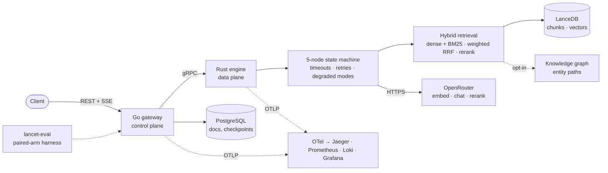
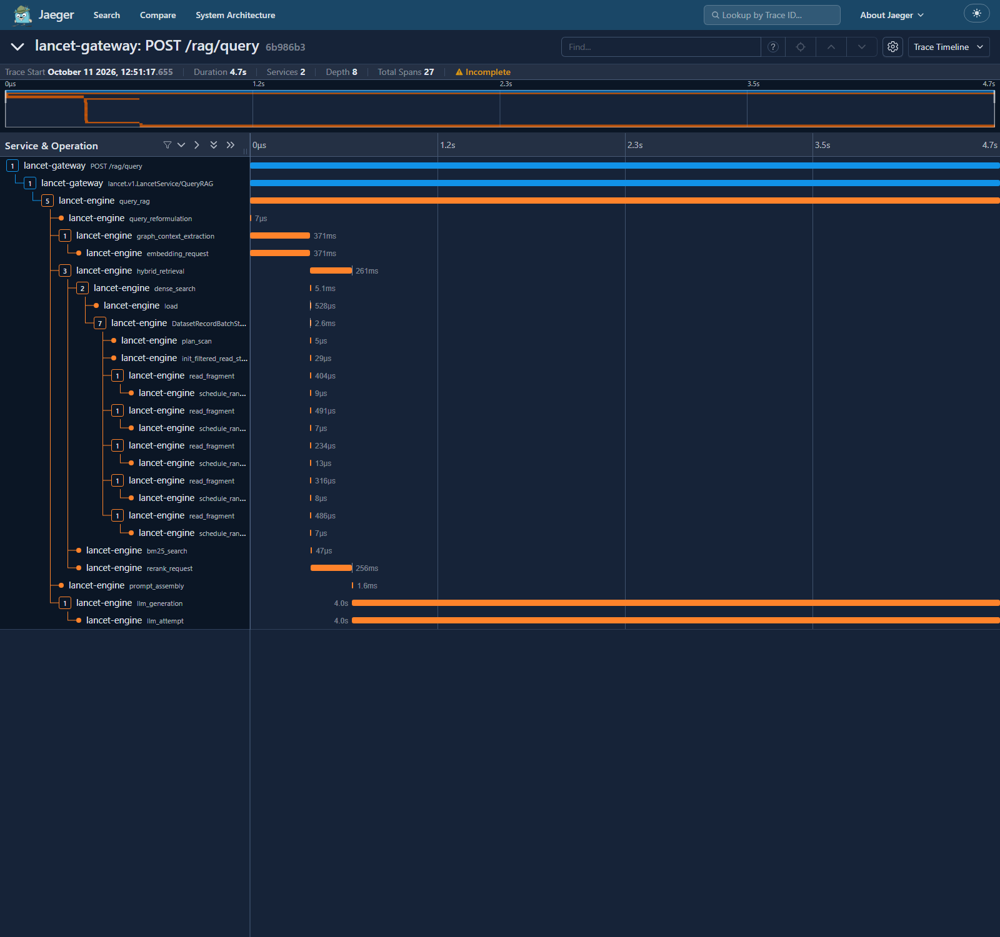
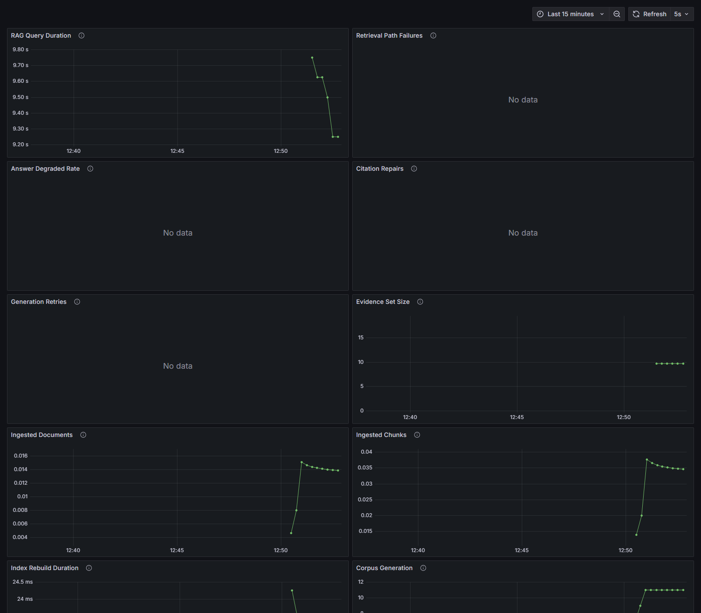

# Lancet

**A retrieval-augmented generation (RAG) engine built from scratch in Rust and Go, with an evaluation harness rebuilt
after I threw out its own first benchmark.**


| **+16 pts / +6 pts** | **3,444** | **250** | **18** |
|:---:|:---:|:---:|:---:|
| [Hits@4 from rerank (+289 ms) / answer usable from metadata](docs/evaluation.md#defaults-that-shipped) | [tests: Rust, Go, Python](docs/case-study.md#directing-ai-agents-at-scale) | [plans, 18 phases, 3 months](docs/build-history.md) | [notice codes on the wire](docs/api-contract.md#notice-codes) |

---

## The benchmark I refused to trust

The first full benchmark run reported **1,000 successful queries** and a **positive graph effect**. The harness's
own records, [read closely](docs/evaluation.md#history), said otherwise:

- **966** of those answers were empty.
- **904** queries had been clipped at a retrieval timeout ([root cause](.planning/phases/06.3.1-fix-retrieval-citation-collapse-and-graph-ablation-measureme/06.3.1-ROOT-CAUSE.md)).
- The two arms being compared, graph on and graph off, shared **1.6%** of their questions.

I threw the result out and rebuilt the measurement before tuning anything:

- fail-closed reporting
- paired per-question statistical tests
- timeout budgets derived from measured latency
- gates committed to git before each paid run

The numbers that came out are smaller, and I trust them.
**[Read the case study →](docs/case-study.md)**

## What actually helped


| Lever | Held-out effect vs. plain hybrid | Ships |
|---|---|---|
| **Rerank** | [**+16 pts Hits@4, +8 pts answer usable**](docs/evaluation.md#defaults-that-shipped) (significant) | on by default |
| **Evidence metadata** | [**+6 pts answer usable**](docs/evaluation.md#defaults-that-shipped) (significant) | on by default |
| Knowledge graph (opt-in) | [no significant gain, +198.9 prompt tokens per request](docs/evaluation.md#graph-cost-reconciled) | off; a request can turn it on |
| Graph-v2, answer format | [no significant gain](docs/evaluation.md#lever-run-seven-arms) | off |

Reranking has a cost: about [+289 ms mean latency](docs/evaluation.md#defaults-that-shipped) per request.
An optional knowledge graph is built, traced and measured too. On this benchmark it didn't earn its cost, so it ships
off, and a request can turn it on. Methods, sample sizes and caveats are in [evaluation](docs/evaluation.md).

## Architecture



What's built from scratch:

- **Hybrid retrieval in Rust.** Dense and BM25 search fused with deterministic weighted Reciprocal Rank Fusion, with
  documented tie rules. Reranking is a pluggable port that falls back to the fused order if the provider fails.
- **Custom orchestrator.** A 5-node async state machine with per-node timeouts derived from measured p95s, retries,
  cancellation, PostgreSQL checkpoints, and typed events streamed over SSE.
- **Degraded modes are part of the API.** Every fallback is a typed notice on the wire, so a client can always tell
  what the system did not do. Model-only answers fail closed by default.
- **Safe index updates.** The index is rebuilt and swapped in staged steps, so a query never reads a half-built index.
- **An evaluation harness built for statistics.** Each question runs once per arm, compared question by question.
  Every request is journaled with provenance. Spend is capped per stage and reconciled to the provider bill, and an
  incomplete run is refused, never published as complete.
- **Opt-in knowledge graph.** Entities and edges are extracted at ingestion. At query time the engine matches the
  question's entity mentions and searches short paths between them, adding the results as one more ranked list. It is
  fully built and observable, and ships off because it didn't measurably help on this benchmark.

## Observability

Every node is a span, and every external call gets a leaf span. Grafana links each trace to its logs.

| One question traced end to end (Jaeger) | Operations dashboard (Grafana) |
|---|---|
|  |  |

The full walkthrough is in [observability](docs/observability.md).

## Try it

You need Docker, Rust, `protoc`, Go, Atlas, uv and an OpenRouter key. Then, from the repository root (bash; the
PowerShell variants are in the full quickstart):

```bash
cp .env.example .env                                            # then set OPENROUTER_API_KEY in .env
set -a && . ./.env && set +a                                    # repeat in each terminal below
docker compose -p lancet-qs --profile observability up -d       # Postgres + the observability stack
(cd gateway && atlas schema apply --env local --auto-approve)
cargo run --manifest-path engine/Cargo.toml --release --bin engine   # terminal 1
cd gateway && go run .                                               # terminal 2
uv run --project eval python eval/scripts/quickstart.py ingest       # terminal 3
# wait for "documents_with_metadata=5 documents=5" in the engine log, then:
uv run --project eval python eval/scripts/quickstart.py query "Who directs Harbor Light Observatory?"
```

The **[full quickstart](docs/quickstart.md)** covers schema setup, the sample corpus, a two-hop question with and
without the graph, an offline re-score of a recorded run, and teardown. That page, not this summary, was followed
verbatim from a fresh clone on Windows 11 and on WSL Ubuntu.

## Read more

| Page | What's there |
|---|---|
| [Case study](docs/case-study.md) | the story, the hard calls, and how AI agents were directed across 250 plans |
| [Evaluation](docs/evaluation.md) | methodology, the three runs of record, and the cost of the graph |
| [Design narrative](docs/design-narrative.md) | the alternatives considered for each major choice, and why they lost |
| [Observability](docs/observability.md) | one question followed through two real traces |
| [API contract](docs/api-contract.md) | request fields and every notice code, pinned to the proto by a test |
| [Limitations](docs/limitations.md) | what v1 doesn't do or measure, the local-only constraint, and the backlog |
| [Build history](docs/build-history.md) | every phase, with its plan count and date |

**Scope, honestly:** v1 is local-only, with no authentication or TLS, and binds to loopback. Results come from one
benchmark (MultiHop-RAG), one generation model and one seed. Details are in [limitations](docs/limitations.md).

Built with AI coding agents (Claude Code with the GSD workflow) under human-held verification gates. Every plan,
review and verification record is in [`.planning/`](.planning).

MIT licensed.
