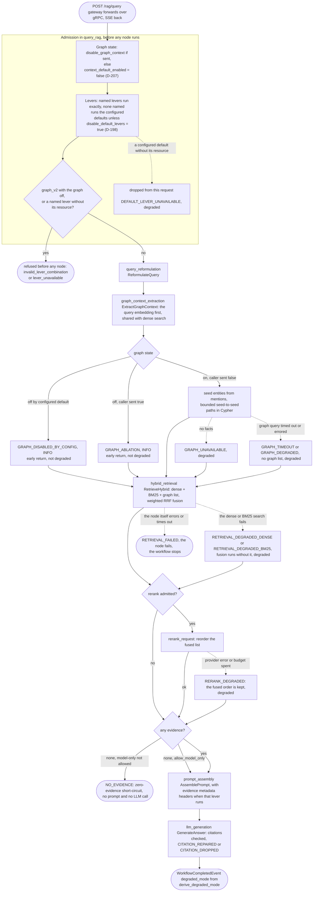
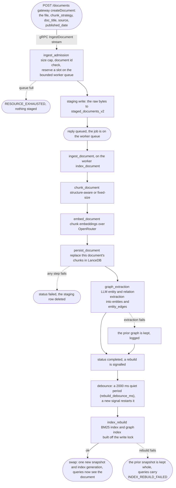

# Design Narrative: Alternatives Considered

> [!NOTE]
> This page is about the decisions that shaped Lancet. It does not report results. For each decision it says what was
> chosen, what was rejected and why, and links the document where the call was made. None of these choices has its own
> ADR file: the reasoning lives in the `.discussion/` planning documents written before the first line of code, and in
> the `.planning/` phase records written while building. Results live on the [evaluation page](evaluation.md). Where
> this page quotes a figure, it is copied verbatim from the source linked beside it: a run of record, the 06.3.6
> closeout, a committed run or diagnosis file, the configuration, or a planning record. The same committed check that
> guards the evaluation page fails this page on any decimal it cannot find in the run sources.

**Seven decisions shaped this system. Four were made before any code existed: a small Rust state machine instead of a
workflow framework, embedded LanceDB instead of a vector service, a custom chunker instead of a framework's, and a Go
gateway beside a Rust engine instead of one language. Three were forced by what the measurements said: a custom,
pre-registered evaluation instead of an off-the-shelf framework, a graph that is fully built and still ships switched
off, and quality levers measured as arms instead of tuned into the defaults. The first four are bets on where custom
engineering pays. The last three are about not believing a number until it has earned it.**

- [A lightweight Rust state machine, not LangGraph or Dify](#a-lightweight-rust-state-machine-not-langgraph-or-dify)
- [Embedded LanceDB, not pgvector or Qdrant](#embedded-lancedb-not-pgvector-or-qdrant)
- [Custom structure-aware chunking, not a framework's](#custom-structure-aware-chunking-not-a-frameworks)
- [A Go gateway and a Rust engine, not one language](#a-go-gateway-and-a-rust-engine-not-one-language)
- [A pre-registered, paired evaluation, not a RAGAS-style framework](#a-pre-registered-paired-evaluation-not-a-ragas-style-framework)
- [The graph is built, measured, and ships default-off](#the-graph-is-built-measured-and-ships-default-off)
- [Levers measured as arms, not tuned](#levers-measured-as-arms-not-tuned)
- Diagrams: [the query path, as shipped](#the-query-path-as-shipped) and
  [the ingestion path, through rebuild-and-swap](#the-ingestion-path-through-rebuild-and-swap)

## A lightweight Rust state machine, not LangGraph or Dify

Lancet answers a question in one fixed sequence: reformulate the query, extract graph context, retrieve, assemble a
prompt, generate. That sequence is the whole orchestration problem. It does not branch into tools, it does not loop,
and it never needs a node it did not know about at compile time. So the orchestrator is a small typed state machine in
Rust: five nodes, a budgeted timeout per node, retries where a retry is safe, a typed notice on the wire for every
degraded path, and a checkpoint per node in PostgreSQL. The [query path diagram](#the-query-path-as-shipped) below
shows it as shipped.

The obvious alternative was a workflow framework. LangGraph models an agent as an explicit graph of states with memory,
durable execution and human-in-the-loop steps, and Dify packages the same idea as a product with a visual editor. Both
were studied, and both were rejected as dependencies for the same reason: the planning document states the intent
plainly as "not to rebuild LangGraph, Dify, or a general-purpose agent framework", but to build "a small, typed,
observable, retryable workflow layer for Lancet's fixed RAG path"
([`lightweight_state_machine_plan.md`](../.discussion/lightweight_state_machine_plan.md), lines 5 to 13). A framework
would have brought a dynamic graph runtime, a DSL and a plugin surface to a pipeline that has five steps, and it would
have hidden exactly the part this project exists to show: what happens at each step when something times out. The
early landscape survey reached the same conclusion from the other side, recommending "a compact state-machine-based
workflow engine inspired by LangGraph concepts but expressed in Rust types"
([`rag_side_project_brainstorming_document.md`](../.discussion/rag_side_project_brainstorming_document.md), the
"Orchestration and LLM piping landscape" and "Small orchestration runtime" sections). The project charter then wrote
the boundary down: a full LangGraph, Dify or generic workflow-engine clone is out of scope
([`PROJECT.md`](../.planning/PROJECT.md), "Out of Scope" and the "Lightweight Rust state machine instead of
LangGraph/Dify clone" row of its Key Decisions).

The question came back once, in Phase 6, when the evaluation and observability work was being specified and a
framework could have been adopted mid-build. The AI-SPEC for that phase looked at LangGraph again and called it the
closest conceptual fit, "genuinely what one would reach for on a greenfield build". It was ruled out a second time on
concrete grounds: it is Python and TypeScript only, adopting it would have replaced a shipped Rust state machine with
285 passing tests, and the checkpointing it offers already existed, PostgreSQL-backed, from Phase 5
([`06-AI-SPEC.md`](../.planning/phases/06-observability-evaluation-polish/06-AI-SPEC.md), the framework table). The
rule that came out of the planning document still holds: borrow the ideas, do not port the code.

What this cost is real. Every behaviour a framework gives for free had to be written and tested here: per-node budgets,
cancellation, the terminal event that is emitted exactly once, the checkpoint writes. What it bought is a pipeline in
which every degraded outcome is a named code a client can read, and every node is a span with its own attributes in the
trace (see the [observability walkthrough](observability.md)).

## Embedded LanceDB, not pgvector or Qdrant

The vector store is LanceDB, embedded in the Rust engine process. Chunks, their vectors and the knowledge graph's
`entities` and `entity_edges` tables all live in one local store, and the graph is queried with Cypher through
`lance-graph`. There is no separate database service for retrieval.

Three directions were kept alive in the early survey: an embedded local store with LanceDB, a self-hosted vector
service with Qdrant, and a relational base with PostgreSQL and pgvector
([`rag_side_project_brainstorming_document.md`](../.discussion/rag_side_project_brainstorming_document.md), "Vector
database and storage landscape" and "Storage decision space for this project"). Qdrant was the strongest rival. It is
written in Rust and built for production vector search, and the survey called it "a very strong fit for a Rust-centered
RAG project". It was rejected because it is a service, one more process to deploy and run beside the engine, and the decision
favoured a store with minimal deployment overhead that the engine owns outright. pgvector was attractive for the opposite reason, because the gateway
already runs PostgreSQL for documents and sessions, and one store for metadata and vectors is a genuine simplification.
It was rejected because it would have tied retrieval to the control plane's database, while the point of the design is
a data plane that owns its own storage and access patterns.

The survey left the choice open on purpose ("local-first with LanceDB, service-oriented with Qdrant, or relationally
integrated with PostgreSQL plus vector support"). The final decision document closed it: LanceDB "embedded directly
within the Rust service to enable fast, local-first, Arrow-native vector retrieval with minimal deployment overhead",
with the graph stored in LanceDB tables beside the chunks
([`final_implementation_decision_document.md`](../.discussion/final_implementation_decision_document.md), section 3,
"Storage & Vector Database Strategy"; [`PROJECT.md`](../.planning/PROJECT.md), the "LanceDB for vector/graph storage"
row).

Embedding the store moved work into the engine. The `lance-graph` and Arrow version compatibility was an unknown big
enough to get its own spike phase before any graph extraction was built (Phase 4). The engine owns its index lifecycle,
so the BM25 index and the graph index are rebuilt off the write lock and swapped in as one snapshot with a new index
generation, which is the end of the [ingestion path](#the-ingestion-path-through-rebuild-and-swap) below. Each of those
is engineering a managed service would have hidden, and each is the kind of engineering this project set out to show.

## Custom structure-aware chunking, not a framework's

Lancet chunks documents with its own chunker: a structure-aware strategy that follows Markdown structure, and a
fixed-size strategy beside it. A request picks the strategy per document, and JSON is always chunked fixed-size.

The alternative was the splitter of a document framework such as LlamaIndex, which offers connectors, indexing and
retrieval abstractions as one assembled stack. The survey treated those stacks as references rather than foundations:
"the strongest project signal in this context may come from understanding their patterns rather than fully depending on
them" ([`rag_side_project_brainstorming_document.md`](../.discussion/rag_side_project_brainstorming_document.md),
"LlamaIndex and related stacks"). It named a custom chunking engine as one of the best investments for the project,
because chunking is "central to RAG quality, highly discussable in interviews, and concrete enough to benchmark
meaningfully" (the "Custom chunking engine" section). The final decision document made it the first item of its
"Custom vs. Framework Focus" section: the core RAG components are custom-built "rather than relying on black-box
frameworks", starting with "a structure-aware, recursive chunker"
([`final_implementation_decision_document.md`](../.discussion/final_implementation_decision_document.md), section 4;
[`PROJECT.md`](../.planning/PROJECT.md), the "Custom chunking and hybrid retrieval" row and the "Core data-plane
customness" constraint). The same reasoning extended to the hybrid retrieval composer that consumes the chunks: dense
search, BM25 and the graph list fused by weighted reciprocal rank fusion with documented tie rules.

One claim the chunker invites is not made. The two strategies exist so they can be compared, and that comparison was
never measured: no evaluation run compares them, so this page does not say which strategy retrieves better, and the
README lists the comparison among its unmeasured claims.

## A Go gateway and a Rust engine, not one language

Lancet is two services. A Go gateway is the control plane: the HTTP API, document upload, the streaming `/rag/query`
endpoint, sessions, and PostgreSQL persistence for documents, sessions and workflow checkpoints. A Rust engine is the
data plane: chunking, embedding, storage, retrieval, graph traversal and the state machine. They talk gRPC over one
Protocol Buffers contract.

The survey left this open too ("Should the project be pure Rust or split between Go and Rust?",
[`rag_side_project_brainstorming_document.md`](../.discussion/rag_side_project_brainstorming_document.md), "Planning
questions that remain intentionally open"). One language would have been simpler to build and to run. The split won
because the two halves have different jobs. The control plane is commodity work, HTTP handlers, sessions and SQL, and
Go does it with little friction. The data plane is where memory, concurrency and latency matter, and Rust is the
language for that. The final decision document records the split as "a clear separation between the control plane and
data plane", with services communicating "via gRPC over a structured Protobuf schema"
([`final_implementation_decision_document.md`](../.discussion/final_implementation_decision_document.md), section 2,
"Architecture & Service Boundaries"), and the charter keeps it as a constraint, not a preference: use the split "unless
a later decision explicitly changes it" ([`PROJECT.md`](../.planning/PROJECT.md), "Constraints").

The split's cost is two toolchains and a contract to keep honest. Generated bindings drifted in Phase 5 and took two
repair plans, so every later contract change landed as one additive regeneration with one review (06-CONTEXT D-74). The
benefit showed up later and unplanned: because the boundary is a published wire contract, the evaluation harness became
a second, independent consumer of it, and a contract regression surfaces as an evaluation failure instead of silent
mis-scoring.

## A pre-registered, paired evaluation, not a RAGAS-style framework

Lancet measures itself with its own harness, `lancet-eval`. Every held-out drive commits its arms, primaries, Holm
families, guards and lever parameters before any data is read. Every comparison is paired per question against a
`hybrid` arm driven the same day. Only a Holm rejection is called significant. Every record passes provenance clauses
before it is scored, and a failure in a zero-tolerance clause makes `score` refuse the run. The method is set out on
the [evaluation page](evaluation.md#methodology).

The early plan was the opposite. The survey named RAGAS, TruLens and DeepEval as the evaluation landscape, and said
that "rebuilding RAGAS, TruLens, or an equivalent evaluation toolkit is unlikely to be a strong use of time"; the
project would emit structured data that such tools could consume
([`rag_side_project_brainstorming_document.md`](../.discussion/rag_side_project_brainstorming_document.md), "Evaluation
landscape" and "Full-featured evaluation frameworks"). An off-the-shelf, metric-oriented framework was the default
path.

The first full benchmark run changed that. On 2026-09-03 the report showed 1,000 successful queries and a positive
graph effect. The harness's own records showed that 966 of the 1,000 answers were empty after node timeouts, that
stream aborts had been recorded as successes, and that the graph's ablation delta compared two arms that shared 1.6% of
their questions
([`06.3.1-ROOT-CAUSE.md`](../.planning/phases/06.3.1-fix-retrieval-citation-collapse-and-graph-ablation-measureme/06.3.1-ROOT-CAUSE.md);
the public account is [`evaluation-fidelity-and-graph-yield.md`](evaluation-fidelity-and-graph-yield.md)). An average
over those records would still have produced a number. Nothing in a metric average asks whether the records being
averaged are real answers, or whether the two arms being compared answered the same questions. The run was caught,
and refused, because the harness checked provenance record by record. The project kept that result as forensic evidence
and spent five phases making the measurement trustworthy before measuring anything else; that history is told once, on
the [evaluation page](evaluation.md#history).

So the harness is not a re-implementation of RAGAS, and it does not try to be. It does not reproduce RAGAS metrics.
What it adds is the part a metric library leaves to its caller: pre-registration committed before the drive and
checked by `score` as a git ancestor, pairing, family-wise error control, null-question guards, and provenance gates
that refuse a run instead of averaging it. Its judged dimensions were calibrated once against a human slice, failed the
floor, and are reported as not findings. RAGAS-style metrics could still be computed from the journals the harness
writes; they would not have caught the 2026-09-03 collapse on their own.

## The graph is built, measured, and ships default-off

The knowledge graph is a complete subsystem. Ingestion extracts entities and relations with an LLM into the `entities`
and `entity_edges` tables. At query time the graph node seeds entities from the question's mentions, runs a bounded,
degree-capped seed-to-seed path search in Cypher, and joins fusion as a third ranked list beside dense and BM25. It has
its own spans in the trace, its own notice codes, and its own scored dimensions. And since Phase 6.4 it is off unless a
request turns it on.

The reason is what the measurements said. After the 06.3.6 default flip, a plain request ran graph v1 together with
rerank and evidence metadata, a combination that was never measured, because every lever arm had been driven with the
graph off (Phase 6.4 D-206). Graph context therefore ships default-off: `[engine.graph] context_default_enabled = false` in
`config/config.toml`, an absent `disable_graph_context` field now means "the configured default", and a request opts in
by sending `"disable_graph_context": false`. A response whose graph is off only by default carries the informational
notice `GRAPH_DISABLED_BY_CONFIG`, which does not mark the response degraded, so a client can always tell why the graph
did not run (Phase 6.4 D-207, recorded in
[`06.4-CONTEXT.md`](../.planning/phases/06.4-docs-suite-verified-quickstart-debt-backlog-promotion-and-v1/06.4-CONTEXT.md)).

Why ship a built subsystem off? Because on MultiHop-RAG it did not pay. No graph arm beat `hybrid` on held-out: on
`answer_usable`, `hybrid+graph` reads -0.0065 in the lever run, and the repaired `hybrid+graph-v2` reads -0.0195
(Holm p 0.4177). The benchmark's questions are mostly two-document news questions. About 42% of graph-arm records found no graph facts at all: the `GRAPH_UNAVAILABLE` notice sits on 149,
150 and 148 of the 351 records of the three graph arms of the lever run, a rate stable across runs and unchanged by
graph-v2 ([evaluation page](evaluation.md#results-the-three-runs-of-record)). Where the graph does contribute, it adds
noise to ranking: the graph-repair run's ranking-quality delta was -0.0807, CI [-0.1362, -0.0259] over 89 pairs, an
interval that excludes zero (a legacy ablation reading that the run of record reports outside its SC-5 qualifying set)
([`06.3.4.1-RUN-OF-RECORD.md`](../.planning/phases/06.3.4.1-retrieval-diagnosis-index-identity-and-graph-yield-repair/06.3.4.1-RUN-OF-RECORD.md)).
And it costs prompt tokens and retrieval time in every run (see [graph cost, reconciled](evaluation.md#graph-cost-reconciled)).

Two ways to make the graph pay were considered before the default changed. "More hops" was rejected as a lever outright:
paths are already seed-to-seed one-hop and two-hop with a degree cap, the questions mostly need two documents, and a
graph that already injects ranking noise would inject more
([`NEXT-STEPS-2026-10-06.md`](../.planning/research/NEXT-STEPS-2026-10-06.md), lever 2). A repair chosen by diagnosis
was tried instead. A pre-registered rule classified the 38 dev questions on which the graph had found no path: 0 alias
splits, 3 with gold entities absent, 15 missing edges and 20 other. With alias splits at zero, entity resolution was out,
and the rule selected graph-list precision, which narrows the chunks the graph contributes to fusion
([`graph_diagnosis.md`](../.planning/phases/06.3.6-quality-levers-measured-as-arms-reranker-graph-repair-by-dia/diagnostic/graph_diagnosis.md);
06.3.6 D-137). That repair became graph-v2, measured on held-out, and it was not significant either.

So the graph is positioned as what it is: a fully built, observable subsystem that did not pay on this benchmark. The
[observability walkthrough](observability.md) traces the same question with the graph off and opted in. Two backlog
directions could change the answer, and they are named here without a promise. Community summaries (backlog 999.1)
would serve global, summary-style questions that MultiHop-RAG does not ask, so they would need a different benchmark
first. Query reformulation (backlog 999.3), HyDE and multi-query expansion, would reuse the reformulation node and the
multi-variant fusion that already exist. Neither is scheduled.

## Levers measured as arms, not tuned

Four quality levers were built in Phase 06.3.6: a reranker, the graph repair, evidence metadata in the prompt, and a
yes/no answer format. None of them was tuned into the system. Each became a switchable arm, measured once on held-out
questions against a `hybrid` arm driven the same day, and only the rule decided which became a default.

The discipline had three parts (06.3.6 D-154 and D-157, in
[`06.3.6-CONTEXT.md`](../.planning/phases/06.3.6-quality-levers-measured-as-arms-reranker-graph-repair-by-dia/06.3.6-CONTEXT.md)).
Iteration happened on dev questions only, with at most two paid dev reads per lever. Every lever parameter (prompt
sentences, the rerank timeout, the precision variant) was frozen in one commit before the held-out drive, and the
held-out set was read once. And a default came only from the pre-registered rule: a Holm rejection with a positive
delta in the decisional family, the null-abstention guard passing, coverage over its floor, and the completeness and
flatness gates passing on both arms. The winners then flipped in one commit outside the measured system, so the run of
record stays the system it measured. The alternative, adjusting a lever until the held-out number looked good, was
rejected because a number tuned on the questions it reports is not a measurement.

The rule decided three of the four levers. Evidence metadata earned its default: `answer_usable` +0.0621, Holm p 0.0077,
with every guard and gate passing. Graph-v2 and the answer format had no Holm rejection and stay off. The reranker is
the one exception, decided by the owner (06.3.6 D-193). Its quality reading was the strongest in the drive,
`answer_usable` +0.0812 (Holm p 0.0032) and Hits@4 +0.1558, both significant. But its latency-flatness gate read MISS,
so the rule gave no default. The miss was traced to the rerank provider, not the engine: its latency went bimodal late
in the drive, the retrieval series with the rerank call subtracted stayed flat, and no call timed out. With no engine,
wire or provenance fix to justify a re-drive (06.3.6 D-192), the owner made rerank a default and attached the caveat to
the decision rather than hiding it: a request that names no lever now pays the rerank call, and in the provider's slow
mode it can pay up to the 2,286 ms rerank budget. The caveat sits beside the default on the
[evaluation page](evaluation.md#defaults-that-shipped), and the outcome of every lever is recorded in
[`06.3.6-CLOSEOUT.md`](../.planning/phases/06.3.6-quality-levers-measured-as-arms-reranker-graph-repair-by-dia/06.3.6-CLOSEOUT.md)
and [`06.3.6-RUN-OF-RECORD.md`](../.planning/phases/06.3.6-quality-levers-measured-as-arms-reranker-graph-repair-by-dia/06.3.6-RUN-OF-RECORD.md).
The reranker is a hosted API model called through OpenRouter rather than a local ONNX cross-encoder, which is why its
latency is a provider's latency; a local inference endpoint is a separate backlog item.

One gap stays open. Rerank and evidence metadata now ship together, and that pair was never measured together
decisionally. The only evidence about combinations is the descriptive `hybrid+all` arm, which also carries graph-v2 and
the answer format. Measuring the shipped shape is deferred to `v1.1`.

## The query path, as shipped

This is the five-node state machine of the [first section](#a-lightweight-rust-state-machine-not-langgraph-or-dify)
as it runs a `/rag/query` today. The node order is `NodeKind` in `engine/src/workflow/node.rs`, and each node is a
span with the name shown on top (the order a trace shows them in). Admission happens in the engine's `query_rag`
before any node runs. It resolves the graph state once, from the request's `disable_graph_context` field if it was
sent and otherwise from `[engine.graph] context_default_enabled`, which ships `false` (D-207). It resolves the levers:
a request that names levers runs exactly those, and a request that names none runs the configured defaults unless it
sends `disable_default_levers` (the D-198 opt-out).

The degraded branches are the ones `derive_degraded_mode` in `engine/src/workflow/mod.rs` counts: a response is
degraded when its answer basis is not retrieval, or when it carries a degrading notice (the graph's
`GRAPH_UNAVAILABLE`, `GRAPH_DEGRADED` and `GRAPH_TIMEOUT`, the two `RETRIEVAL_DEGRADED_*` codes, `RETRIEVAL_FAILED`,
`RERANK_DEGRADED`, `DEFAULT_LEVER_UNAVAILABLE`, `CITATION_DROPPED`, `MODEL_ONLY`, the three index codes, and
`BASIS_RECONCILED` unless it only records a normalised grounded abstention). The two
graph-off codes, `GRAPH_DISABLED_BY_CONFIG` and `GRAPH_ABLATION`, are informational and never mark a response degraded.
Three details on the diagram are easy to miss. The graph node runs before retrieval because it computes the query
embedding that the dense search also uses, so it holds that cost even when the graph is off. The rerank call runs
inside `hybrid_retrieval`, as a leaf span of that node, not as a sixth node. And any node that times out stops the
workflow, so the terminal event reports the failure instead of an answer.

## The ingestion path, through rebuild-and-swap

This is where the [embedded store](#embedded-lancedb-not-pgvector-or-qdrant) costs its keep: the engine owns the index
lifecycle. An upload is admitted and staged synchronously, then chunked, embedded, stored and graph-extracted by a
background worker, and it becomes visible to queries only when a debounced rebuild swaps in a new index snapshot.

The staging write is what makes an accepted upload durable. If the engine stops before the worker finishes, the staged
jobs are replayed at the next start. The debounce exists because a batch upload would otherwise rebuild the indexes once
per document. The `index_rebuild` span carries links to the `ingest_document` spans that triggered it, so the
[observability walkthrough](observability.md) can follow one upload from the gateway to the swap. The swap is also where
evidence metadata comes back after a fresh start: over an empty store the engine drops that default lever at boot with
a warning, and the rebuild that swaps in documents carrying metadata restores it (06.3.6 D-194).
