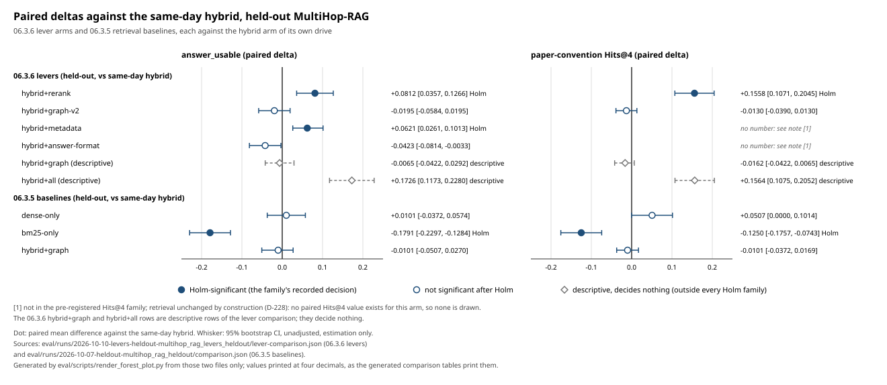

# Evaluation Methodology and Results

> [!NOTE]
> No new benchmark number comes from Phase 6.4. Every figure on this page is quoted from a run of record, the 06.3.6
> closeout, a committed run file, `config/config.toml`, or the output of the forest-plot script, and the file is named
> beside each table.
> Nothing here is re-derived or re-rounded. A committed check fails the page if any decimal on it is missing from
> those sources.

**Three runs of record measure Lancet on MultiHop-RAG. On the held-out split, the rerank lever and the evidence-metadata
lever each beat the same-day `hybrid` arm after Holm correction, and both now ship as defaults. The knowledge graph is
built, reaches retrieval, and is observable, but no graph arm beat `hybrid` on held-out, and it costs prompt tokens and
retrieval time. Each reading below carries its caveats: the gate misses as recorded, the uncalibrated judge, and the
fact that the shipped default combination was never measured as one arm.**

- [Methodology](#methodology)
- [Results: the three runs of record](#results-the-three-runs-of-record)
- [The forest plot](#the-forest-plot)
- [Defaults that shipped](#defaults-that-shipped)
- [Graph cost, reconciled](#graph-cost-reconciled)
- [History](#history)
- [Reproduce](#reproduce)

## Methodology

**Corpus and splits.** The benchmark is MultiHop-RAG, a news multi-hop question set (arXiv 2401.15391), indexed as a
346-document subset. Questions are split into a dev pool, where every lever parameter was set, and a held-out pool of
351 questions, read once per phase: 308 in the population G (answerable questions whose evidence the index holds whole)
and 43 null. The held-out split is pinned by its hash
(`split_sha256` in each journal header). The graph-repair run used a separate 100-question diagnostic sample.

**Pre-registration before data.** Each held-out phase commits a pre-registration (`PREREGISTRATION_06_3_5`,
`PREREGISTRATION_06_3_6`) holding the arms, the primaries, the families and the guards (and in 06.3.6 every lever
parameter) before the drive starts. `score` refuses a held-out journal unless that commit is a git ancestor of HEAD and older than the
journal header (06-CONTEXT D-73). For 06.3.6 the freeze commit `e472a2d4` holds the pre-registration, every lever
parameter and both corpus configs in one commit.

**Paired tests and two Holm families.** Every comparison is paired per question against the `hybrid` arm of the same
drive. The test is the exact two-sided paired sign-flip test (the exact McNemar test) over the discordant pairs. There
are two Holm families, one per primary (`answer_usable` and paper-convention Hits@4), each at a family-wise error rate
of 0.05. Across both, the family-wise rate can reach 0.10 (the Bonferroni bound), and the generated reports state it.
In 06.3.6 the `answer_usable` family is decisional (m = 4) and Hits@4 is supporting (m = 2). Only a Holm rejection is
called significant.

**Confidence intervals.** CIs are 95% percentile bootstrap intervals (B = 10000, seed 42), labelled **unadjusted,
estimation only**. A CI that excludes 0 without a Holm rejection is reported as exactly that and decides nothing.

**Guards.** A lever earns a default only if it also passes the null-abstention guard (D-148). The guard reads the 43 null
questions: `b` counts null pairs where `hybrid` abstains and the lever arm does not, `c` the reverse, and the net loss
`b - c` over the pairs must stay within a margin of 0.10 (one-sided 95% bound; the guard needs 35 paired null questions).
A larger value is a worse arm. The direction is stated as the code computes it; review finding B-IN-07 corrected the
`null_guard_margin` docstring in `eval/src/lancet_eval/thresholds.py`, which had it inverted. The null population
is coarse at n = 43, and the run of record says so.

**Provenance gates.** `score` checks every record against provenance clauses `a` to `j`
(`eval/src/lancet_eval/provenance.py`). A failure in a zero-tolerance clause (`a`, `b`, `c`, `d`, `f`, `h`, `j`) makes
`score` refuse the run. Clauses `e` and `i` count the record and exclude it from the paired population, and `g` is
corroboration only. The gates SC-1 (completeness) and SC-2 (error mode and latency flatness) are computed by
`unpark_gates` and quoted below as written. A MISS is never relabelled.

**Dev-only iteration, one held-out read, defaults only by rule.** Prompt sentences, timeouts and the graph-v2 setting
were set on dev reads only, frozen, then read once on held-out. A lever becomes a default only by the pre-registered
rule: a Holm rejection with a positive delta in the decisional family, guard 1 passing, coverage over the floor, and
SC-1 and SC-2 passing on both arms. The one exception is rerank: its SC-2 reads MISS, so the rule gives no default,
and the owner decided by disposition D-193 (see [Defaults that shipped](#defaults-that-shipped)).

**Why a custom harness.** The refused 2026-09-03 run (see [History](#history)) is why this harness checks provenance on
every record and pairs every comparison. The reasoning for building a pre-registered, paired, Holm-corrected harness
with provenance gates instead of adopting a RAGAS-style framework is in the [design narrative](design-narrative.md).

## Results: the three runs of record

### Graph-repair run: drive 2

Phase 06.3.4.1, run `eval/runs/2026-10-06-drive2-multihop_rag_diag/` (index generation `lance-702`, `result_hash`
`c6db7a116d65fbb1`). A 100-question diagnostic sample, 90 answerable and 10 null, driven graph-on and graph-off: 200
records, header `partial` false. Source:
[`06.3.4.1-RUN-OF-RECORD.md`](../.planning/phases/06.3.4.1-retrieval-diagnosis-index-identity-and-graph-yield-repair/06.3.4.1-RUN-OF-RECORD.md),
"Gate readings (computed)":

| Gate | Status | Value | n | 95% CI | Note |
|---|---|---|---|---|---|
| SC-1 | PASS | n/a | 200 | n/a | header `partial` false equals `completeness_comparison()` (expected `partial` false), `report.json` present, 0 missing units |
| SC-4 | PASS | 0.6629 (59/89) over pairs(G) | 89 | Wilson [0.5598, 0.7526] | floor 0.20 met; Wilson lower bound 0.5598 against the committed clause 0.098 |
| SC-5 | PASS | composition change 0.5385 (35/65) over pairs(V) | 65 | Wilson [0.4185, 0.6541] | floor 0.10 met (rule (a)); rule (b) not met (no paired delta CI excludes 0); `negative` flag false |
| SC-2 (disclosure) | PASS | n/a | 200 | n/a | error mode and flatness both pass |
| D-69 companion (disclosure) | PASS | 0.0101 (2/199) | 199 | Wilson [0.0028, 0.0359] | `citation_marker_mismatch` 0 |
| SC-3 (disclosure) | PASS | 0.5778 (52/90) | 90 | Wilson [0.4746, 0.6746] | floor 0.512 |

Paired deltas, graph-on minus graph-off (bootstrap 95% CI, B = 10 000, seed 42), from the same file:

| Metric | pairs(V), n 65, coverage 1.0 | pairs(G), n 89, coverage 0.9889 |
|---|---|---|
| coverage@4 | -0.0141 [-0.0577, 0.0295] | -0.0103 [-0.0440, 0.0215] |
| `answer_usable` | -0.0308 [-0.0923, 0.0308] | -0.0112 [-0.0562, 0.0337] |
| `final_answer_em` | -0.0154 [-0.0769, 0.0308] | 0.0000 [-0.0449, 0.0449] |
| latency (ms) | +1596.3 [934.8, 2261.1] | +1220.6 [692.3, 1767.5] |
| prompt tokens | +209.6 [154.7, 267.9] | +211.0 [163.3, 260.5] |

**Decision (D-83):** `all-pass-close`, the user's reply on 2026-10-06. No gate missed, nothing was iterated, and the
0.20 floor was not amended. The run shows the graph now reaches and changes retrieval. It does not show the graph improves
answers.

**Three standing disclosures** travel with this run (they are reported, not gated):

1. **Negative, non-significant paired quality deltas, and the cost.** Every quality CI over pairs(V) includes 0, so the
   committed `negative` flag is false. The legacy `graph_ablation_delta_ranking_quality` in `report.json` is -0.0807, CI
   [-0.1362, -0.0259], over 89 pairs, and that CI excludes 0. The record left "whether the graph path earns its cost" to
   Phase 6.4; the later readings answer it in [Graph cost, reconciled](#graph-cost-reconciled).
2. **Mid-drive provider switch.** From request ordinal 165 the served provider changed from OpenInference to Sail
   Research (one served model throughout). Graph-off `answer_usable` in G is 46/74 on OpenInference and 6/16 on Sail
   Research. The provider is not a controlled variable in this run.
3. **Graph-off retrieved-set difference against drive 1b.** The final retrieved set differs on 4 of 100 questions, at
   ranks 6 to 8 only, and the cause is undetermined.

### Baseline run: four retrieval arms

Phase 06.3.5, run `eval/runs/2026-10-07-heldout-multihop_rag_heldout/` (`lance-702`). Four arms (`dense-only`,
`bm25-only`, `hybrid`, `hybrid+graph`) on the held-out split, 1,404 records. Source:
[`06.3.5-RUN-OF-RECORD.md`](../.planning/phases/06.3.5-retrieval-ablation-matrix-paper-convention-metrics-judged-pa/06.3.5-RUN-OF-RECORD.md).

**The SC-2 gate missed, and that reading stands.** In the run of record's words: "The plurality error class is
`timeout`: 12 query-embedding timeouts at 2,001-2,016 ms against the committed 2,000 ms budget, 12 of 1,404 records
(0.85%). The owner continued post-hoc instead of re-driving or halting (outcome id `continue-with-disclosure (owner,
post-hoc)`), so every number below is a reading on a drive whose SC-2 gate missed." The gate readings, as written by
`unpark_gates`:

| Reading | dense-only | bm25-only | hybrid | hybrid+graph | pooled |
|---|---|---|---|---|---|
| SC-1 | PASS (351) | PASS (351) | PASS (351) | PASS (351) | PASS (1404) |
| SC-2 | MISS (351): arm dense-only: timeout is a dominant error class (tied or plurality): {'timeout': 4, 'other': 1} | PASS (351) | MISS (351): arm hybrid: timeout is a dominant error class (tied or plurality): {'timeout': 6} | MISS (351): arm hybrid+graph: timeout is a dominant error class (tied or plurality): {'timeout': 2} | MISS (1404): timeout is a dominant error class (tied or plurality): {'timeout': 12, 'other': 1} |

The comparison stands on the paired population P4: 296 of the 308 held-out G questions (coverage 0.961 against the 0.80
floor), where a question that errored on any arm is excluded from every arm.

**Retrieval, paper convention** (ID rule on the pre-truncation ranking), with the paper's own rows cited and marked not
comparable:

| row | Hits@4 | Hits@10 | MRR@10 | MAP@10 | label |
| --- | --- | --- | --- | --- | --- |
| dense-only (P4) | 0.7399 [0.6870, 0.7865] (n=296) | 0.8514 [0.8063, 0.8874] (n=296) | 0.5620 [0.5174, 0.6069] (n=296) | 0.2745 [0.2499, 0.2982] (n=296) | ID rule |
| bm25-only (P4) | 0.5642 [0.5072, 0.6195] (n=296) | 0.6757 [0.6204, 0.7265] (n=296) | 0.4564 [0.4066, 0.5051] (n=296) | 0.2138 [0.1889, 0.2393] (n=296) | ID rule |
| hybrid (P4) | 0.6892 [0.6343, 0.7392] (n=296) | 0.8311 [0.7842, 0.8695] (n=296) | 0.5719 [0.5235, 0.6182] (n=296) | 0.2762 [0.2505, 0.3016] (n=296) | ID rule |
| hybrid+graph (P4) | 0.6791 [0.6239, 0.7297] (n=296) | 0.8108 [0.7623, 0.8513] (n=296) | 0.5362 [0.4880, 0.5820] (n=296) | 0.2589 [0.2338, 0.2845] (n=296) | ID rule |
| dense-only (script-faithful, all 308 G) | 0.7305 [0.6784, 0.7770] (n=308) | 0.8377 [0.7924, 0.8746] (n=308) | 0.5510 [0.5065, 0.5957] (n=308) | 0.2705 [0.2467, 0.2950] (n=308) | ID rule |
| bm25-only (script-faithful, all 308 G) | 0.5714 [0.5156, 0.6255] (n=308) | 0.6851 [0.6312, 0.7344] (n=308) | 0.4616 [0.4131, 0.5110] (n=308) | 0.2170 [0.1925, 0.2419] (n=308) | ID rule |
| hybrid (script-faithful, all 308 G) | 0.6818 [0.6278, 0.7313] (n=308) | 0.8182 [0.7713, 0.8572] (n=308) | 0.5667 [0.5187, 0.6140] (n=308) | 0.2738 [0.2486, 0.2996] (n=308) | ID rule |
| hybrid+graph (script-faithful, all 308 G) | 0.6786 [0.6245, 0.7283] (n=308) | 0.8084 [0.7608, 0.8485] (n=308) | 0.5400 [0.4925, 0.5858] (n=308) | 0.2614 [0.2365, 0.2867] (n=308) | ID rule |
| Paper reference (cited; not comparable, see caveat): bge-large-en-v1.5 | 0.5221 | 0.6718 | 0.4298 | 0.3423 | arXiv 2401.15391 v1, Table 5 |
| Paper reference (cited; not comparable, see caveat): voyage-02 | 0.4619 | 0.6506 | 0.3934 | 0.3143 | arXiv 2401.15391 v1, Table 5 |

The paper rows are not a baseline. The paper's setup is dense-only, with LlamaIndex 256-token chunks and a different
embedder. Its scorer counts text matches and excludes nulls. Lancet's population is G-restricted, which raises its
figures relative to a full-population reading, and Lancet indexes a 346-document subset of the corpus. The full (a)-(f) caveat is in the run of record,
"Paper reference row and caveat (D-103)".

**Lancet's own answer metrics** on the same population, beside the retrieval metrics:

| metric | dense-only | bm25-only | hybrid | hybrid+graph |
| --- | --- | --- | --- | --- |
| `answer_usable_p4` | 0.5811 [0.5242, 0.6359] (n=296) | 0.3919 [0.3380, 0.4486] (n=296) | 0.5709 [0.5140, 0.6261] (n=296) | 0.5608 [0.5039, 0.6162] (n=296) |
| `answer_usable_sc3_definition` | 0.5875 [0.5313, 0.6415] (n=303) | 0.3994 [0.3462, 0.4550] (n=308) | 0.5677 [0.5114, 0.6222] (n=303) | 0.5654 [0.5093, 0.6198] (n=306) |
| `final_answer_em` | 0.5608 [0.5039, 0.6162] (n=296) | 0.3818 [0.3283, 0.4383] (n=296) | 0.5574 [0.5005, 0.6129] (n=296) | 0.5574 [0.5005, 0.6129] (n=296) |
| `gold_containment` | 0.6757 [0.6204, 0.7265] (n=296) | 0.5574 [0.5005, 0.6129] (n=296) | 0.6622 [0.6065, 0.7137] (n=296) | 0.6453 [0.5892, 0.6976] (n=296) |
| `final_answer_missing_rate` | 0.0000 [0.0000, 0.0128] (n=296) | 0.0000 [0.0000, 0.0128] (n=296) | 0.0000 [0.0000, 0.0128] (n=296) | 0.0000 [0.0000, 0.0128] (n=296) |

**The two Holm families** (m = 3 each, reference `hybrid`; the CI column is unadjusted, estimation only):

Family `paper_hits_at_4` (ID rule):

| comparison | n pairs | discordant (+/-) | raw p (exact) | Holm-adjusted p | decision | delta | 95% CI (unadjusted, estimation only) | note | text-rule decision | matching-rule robustness |
| --- | --- | --- | --- | --- | --- | --- | --- | --- | --- | --- |
| dense-only - hybrid | 296 | 37/22 | 0.0674 | 0.1349 | not significant | 0.0507 | [0.0000, 0.1014] |  | not significant | robust to the matching rule |
| bm25-only - hybrid | 296 | 14/51 | 0.0000 | 0.0000 | significant | -0.1250 | [-0.1757, -0.0743] |  | significant | robust to the matching rule |
| hybrid+graph - hybrid | 296 | 6/9 | 0.6072 | 0.6072 | not significant | -0.0101 | [-0.0372, 0.0169] |  | not significant | robust to the matching rule |

Family `answer_usable` (on P4):

| comparison | n pairs | discordant (+/-) | raw p (exact) | Holm-adjusted p | decision | delta | 95% CI (unadjusted, estimation only) | note |
| --- | --- | --- | --- | --- | --- | --- | --- | --- |
| dense-only - hybrid | 296 | 27/24 | 0.7798 | 1.0000 | not significant | 0.0101 | [-0.0372, 0.0574] |  |
| bm25-only - hybrid | 296 | 7/60 | 0.0000 | 0.0000 | significant | -0.1791 | [-0.2297, -0.1284] |  |
| hybrid+graph - hybrid | 296 | 15/18 | 0.7283 | 1.0000 | not significant | -0.0101 | [-0.0507, 0.0270] |  |

The `0.0000` p-values are the four-decimal rendering. `comparison.json` stores the bm25-only values exactly: on
`paper_hits_at_4`, raw p 4.47522484948754e-06 and Holm p 1.342567454846262e-05; on `answer_usable`, raw p
1.3280368233066497e-11 and Holm p 3.984110469919949e-11. Read as computed: in both families only bm25-only against
`hybrid` is a Holm rejection, and `hybrid+graph` is not a rejection in either.

**Judged rows are not findings (D-208).** Both judged dimensions are uncalibrated under D-114, at n = 20 against a
floor of 0.70:

| dimension | scored pairs | QWK | QWK 95% CI | floor | D-114 label | Spearman | exact agreement |
| --- | --- | --- | --- | --- | --- | --- | --- |
| groundedness | 20 | -0.0256 | [-0.3226, 0.2565] | 0.7000 | uncalibrated | -0.0382 | 0.2000 |
| faithfulness | 20 | 0.0659 | [-0.3006, 0.5914] | 0.7000 | uncalibrated | 0.0228 | 0.5000 |

The run of record publishes the judged means and paired judged deltas, labelled, and reads none of them as a finding.
This page does the same: no judged figure is a v1 result. 06.3.6 ran no judge pass (D-153), and the fresh calibration
is deferred to `v1.1` (D-208).

### Lever run: seven arms

Phase 06.3.6, run `eval/runs/2026-10-10-levers-heldout-multihop_rag_levers_heldout/` (`lance-703`, pre-registration
`PREREGISTRATION_06_3_6`). Seven arms on the held-out split: 351 questions (308 G, 43 null) x 7 arms = 2,457 records.
Generation model `deepseek/deepseek-v4-flash-0731`, served by Sail Research on every record; embedding model
`voyageai/voyage-4-large`; rerank model `voyageai/rerank-2.5-lite`. Sources:
[`06.3.6-RUN-OF-RECORD.md`](../.planning/phases/06.3.6-quality-levers-measured-as-arms-reranker-graph-repair-by-dia/06.3.6-RUN-OF-RECORD.md)
and [`06.3.6-CLOSEOUT.md`](../.planning/phases/06.3.6-quality-levers-measured-as-arms-reranker-graph-repair-by-dia/06.3.6-CLOSEOUT.md).

**Gate readings, misses not relabelled.** SC-2 reads MISS on `hybrid+rerank`, `hybrid+all` and the pooled line; SC-1
reads PASS everywhere. The owner's reply was `continue-with-disclosure`, recorded as D-192:

| Reading | hybrid | hybrid+graph | hybrid+rerank | hybrid+metadata | hybrid+answer-format | hybrid+graph-v2 | hybrid+all | pooled |
|---|---|---|---|---|---|---|---|---|
| SC-1 | PASS (351) | PASS (351) | PASS (351) | PASS (351) | PASS (351) | PASS (351) | PASS (351) | PASS (2457) |
| SC-2 | PASS (351) | PASS (351) | **MISS** (351): flatness `decay_present` | PASS (351) | PASS (351) | PASS (351) | **MISS** (351): flatness `decay_present` | **MISS** (2457): flatness `decay_present` |
| D-69 companion (disclosure) | PASS | PASS | PASS | PASS | PASS | PASS | PASS | PASS |

The cause recorded for the miss is rerank-provider latency drift. Rerank latency stays near 300 ms for about the first
560 of 702 calls, then turns bimodal, with a slow mode of about 950 to 1,460 ms. On `hybrid+rerank` the first-50 median
is 300.5 ms and the last-50 median 1,032.5 ms. Timeouts are 0 on every arm, so these are flatness misses. The
RetrieveHybrid series with the rerank call subtracted reads flat. The maximum rerank latency is 1,462 ms against the
frozen 2,286 ms budget. Rerank's quality readings do not depend on latency, but the latency caveat travels with the rerank
default.

**Decisional family `answer_usable`** (m = 4, alpha = 0.05):

| lever arm | n (P_X) | n_pos | n_neg | delta | 95% CI (unadjusted, estimation only) | exact p | Holm p | decision | mean arm | mean `hybrid` on P_X |
|---|---|---|---|---|---|---|---|---|---|---|
| `hybrid+rerank` | 308 | 39 | 14 | +0.0812 | [0.0357, 0.1266] | 0.0008 | 0.0032 | **significant** | 0.6526 | 0.5714 |
| `hybrid+graph-v2` | 308 | 16 | 22 | -0.0195 | [-0.0584, 0.0195] | 0.4177 | 0.4177 | not significant | 0.5519 | 0.5714 |
| `hybrid+metadata` | 306 | 28 | 9 | +0.0621 | [0.0261, 0.1013] | 0.0026 | 0.0077 | **significant** | 0.6340 | 0.5719 |
| `hybrid+answer-format` | 307 | 12 | 25 | -0.0423 | [-0.0814, -0.0033] | 0.0470 | 0.0941 | not significant (CI excludes 0; not significant after Holm) | 0.5309 | 0.5733 |

**Supporting family `paper_hits_at_4`** (m = 2, alpha = 0.05):

| lever arm | n (P_X) | n_pos | n_neg | delta | 95% CI (unadjusted, estimation only) | exact p | Holm p | decision | mean arm | mean `hybrid` |
|---|---|---|---|---|---|---|---|---|---|---|
| `hybrid+rerank` | 308 | 58 | 10 | +0.1558 | [0.1071, 0.2045] | 0.0000 | 0.0000 | **significant** | 0.8539 | 0.6981 |
| `hybrid+graph-v2` | 308 | 6 | 10 | -0.0130 | [-0.0390, 0.0130] | 0.4545 | 0.4545 | not significant | 0.6851 | 0.6981 |

The rerank Hits@4 `0.0000` values are the four-decimal rendering; `lever-comparison.json` stores raw p
2.361627111046021e-09 and Holm p 4.723254222092042e-09. Metadata and answer-format are not in the supporting family:
they change the prompt, so their retrieval is unchanged by construction, and the pre-registration gave them no paired
Hits@4 test.

**Guard 1: null-abstention paired drop** (D-148, margin 0.10, N_X = 43, needs 35):

| arm | decisional | b | c | net loss | one-sided 95% bound | reading |
|---|---|---|---|---|---|---|
| `hybrid+metadata` | yes | 0 | 1 | -0.0233 | 0.0209 | PASS |
| `hybrid+answer-format` | yes | 1 | 1 | 0.0000 | 0.0442 | PASS |
| `hybrid+rerank` | no (reported) | 2 | 0 | 0.0465 | 0.0465 | would pass |
| `hybrid+graph-v2` | no (reported) | 0 | 0 | 0.0000 | 0.0000 | would pass |

**The `default_decision` rows**, as the run of record states them:

| lever | default_decision | answer_usable | delta | Hits@4 support | reasons |
|---|---|---|---|---|---|
| `hybrid+rerank` | **default (owner disposition, D-193)** | significant (Holm p 0.0032) | +0.0812 | significant (+0.1558) | Holm rejection with positive delta on both families; guard 1 would pass (b = 2, c = 0); but SC-2 reads MISS on the arm, so the mechanical rule (O16, D-177) does not give a default and the owner decided; D-193: default-on, with the D-192 latency caveat recorded beside the decision |
| `hybrid+graph-v2` | stays off: not significant | not significant (Holm p 0.4177) | -0.0195 | not significant (-0.0130) | no Holm rejection |
| `hybrid+metadata` | **default** | significant (Holm p 0.0077) | +0.0621 | n/a (not in the supporting family) | all conditions hold: Holm rejection with positive delta, guard 1 PASS (b = 0, c = 1, bound 0.0209), coverage 0.994, SC-1 and SC-2 PASS on `hybrid` and on `hybrid+metadata` |
| `hybrid+answer-format` | stays off: not significant | not significant (Holm p 0.0941) | -0.0423 | n/a (not in the supporting family) | no Holm rejection (CI excludes 0 on the harm side; not significant after Holm) |

**Descriptive rows** (D-140; outside every Holm family, they decide nothing):

| row | n | primary | delta | 95% CI (unadjusted, estimation only) | n_pos | n_neg |
|---|---|---|---|---|---|---|
| `hybrid+graph` - `hybrid` | 308 | `answer_usable` | -0.0065 | [-0.0422, 0.0292] | 14 | 16 |
| `hybrid+graph` - `hybrid` | 308 | `paper_hits_at_4` | -0.0162 | [-0.0422, 0.0065] | 5 | 10 |
| `hybrid+graph-v2` - `hybrid+graph` | 308 | `answer_usable` | -0.0130 | [-0.0455, 0.0195] | 11 | 15 |
| `hybrid+graph-v2` - `hybrid+graph` | 308 | `paper_hits_at_4` | +0.0032 | [-0.0097, 0.0162] | 3 | 2 |
| `hybrid+all` - `hybrid` | 307 | `answer_usable` | +0.1726 | [0.1173, 0.2280] | 68 | 15 |
| `hybrid+all` - `hybrid` | 307 | `paper_hits_at_4` | +0.1564 | [0.1075, 0.2052] | 58 | 10 |

`hybrid+all` carries every declared lever (rerank, metadata, answer-format and graph-v2), so it is not the "rerank plus
metadata" combination that shipped. The graph-v2 repair moved the graph arm's `answer_usable` by -0.0130 and its Hits@4
by +0.0032, so the repair did not move the retrieved evidence measurably.

**Latency, prompt-token cost and spend per arm** (reported only; they gate nothing):

| arm | records | latency mean ms (total) | latency p95 ms | RetrieveHybrid mean ms | prompt tokens mean | harness spend USD (embeddings on) | per record USD |
|---|---|---|---|---|---|---|---|
| `hybrid` | 351 | 8301 | 11757 | 96.4 | 2255 | 0.2507 | 0.000714 |
| `hybrid+graph` | 351 | 8407 | 11818 | 108.7 | 2431 | 0.2536 | 0.000723 |
| `hybrid+rerank` | 351 | 8634 | 12397 | 555.7 | 2299 | 0.2952 | 0.000841 |
| `hybrid+metadata` | 351 | 8328 | 11828 | 97.0 | 2710 | 0.2792 | 0.000796 |
| `hybrid+answer-format` | 351 | 7977 | 11705 | 95.8 | 2340 | 0.2534 | 0.000722 |
| `hybrid+graph-v2` | 351 | 8540 | 12361 | 108.5 | 2432 | 0.2573 | 0.000733 |
| `hybrid+all` | 351 | 9105 | 12106 | 586.5 | 3029 | 0.3377 | 0.000962 |

These are unpaired arm means over all 351 records. The paired cost readings on P_X are in the run of record's prose: rerank
adds +289 ms of mean total latency [11, 571], +458 ms of RetrieveHybrid time and +58 prompt tokens; metadata adds +471
prompt tokens with no latency change (-26 ms [-304, 266]). The settled OpenRouter account cost of the drive was $0.522036,
against a harness estimate of $1.927237.

**Disclosures that stand with this run.**

- **Interaction caveat.** The shipped defaults, rerank plus metadata, were never tested together decisionally.
  `hybrid+all` is the only evidence about combinations, and it is descriptive (see
  [Defaults that shipped](#defaults-that-shipped)).
- **`alias_split` cannot hold for 8 questions.** The entity-resolution diagnosis used a parameter-free `alias_split`
  predicate chosen blind, which can under-detect vector-only aliases. The run of record's D-187 note records that 8
  empty-gold null-type questions could tilt the plurality toward `absent`. The diagnosis table reads alias_split 0, absent
  3, missing_edge 15, other 20, and the plurality `other` selected graph-list precision, so the graph-v2 arm was built and
  measured. Its result is the not-significant row above.
- **`GRAPH_UNAVAILABLE`.** The notice "Graph query returned no facts for this query" appears on 149 `hybrid+graph`, 150
  `hybrid+graph-v2` and 148 `hybrid+all` records, of 351 each. The rate is stable across runs and unchanged by graph-v2.
- **Scope.** The held-out population is one corpus (MultiHop-RAG, 351 questions), one generation model from one provider
  and one seed, and the null guard rests on 43 questions. A default made here is a statement about this system on this
  population.

## The forest plot

*Every arm's paired delta against the `hybrid` arm of its own drive, with its 95% CI (unadjusted, estimation only), on
`answer_usable` and paper-convention Hits@4. Filled points are Holm-significant in their family, and the diamonds
(`hybrid+graph` and `hybrid+all` in the lever run) are descriptive. The `hybrid+metadata` and `hybrid+answer-format`
Hits@4 cells carry no number. Their footnote reads "not in the pre-registered Hits@4 family; retrieval unchanged by
construction" (D-228). The plot is generated by
[`eval/scripts/render_forest_plot.py`](../eval/scripts/render_forest_plot.py) from `lever-comparison.json` and
`comparison.json` only. [`docs/assets/eval-forest.json`](assets/eval-forest.json) lists every plotted value with the file
and JSON path it was read from, and `eval/tests/test_forest_plot.py` re-reads each one.*

This chart replaces the interim four-arm bar chart of Phase 06.3.5 for the docs. The frozen run's own `chart.svg` and its
footnote stay in `eval/runs/2026-10-07-heldout-multihop_rag_heldout/` unchanged.

## Defaults that shipped

The default flip is commit `3d765ea3` (`feat(06.3.6-22)`), one commit outside the measured system (06.3.6 D-157). It sets
`[engine.levers] defaults = ["rerank", "evidence_metadata"]` in `config/config.toml`.

- **`rerank` is on by owner disposition D-193, with the D-192 latency caveat beside it.** On held-out, rerank's
  `answer_usable` is +0.0812 (Holm p 0.0032) and its Hits@4 +0.1558, both significant, but its SC-2 flatness gate reads
  MISS, so the pre-registered rule gives no default and the owner decided. The cost: on P_X, rerank adds +289 ms of mean
  total latency and +458 ms of RetrieveHybrid time. A request that names no lever now pays the rerank call, and in the
  provider's slow mode it can pay up to the 2,286 ms rerank budget (`rerank_timeout_ms = 2286` in `config/config.toml`,
  inside `retrieve_timeout_ms = 3080`). The slow mode was observed once, on this drive.
- **`evidence_metadata` is on by the pre-registered rule.** `answer_usable` +0.0621, Holm p 0.0077; guard 1 PASS
  (b 0, c 1, bound 0.0209); coverage 0.994; SC-1 and SC-2 PASS on `hybrid` and on `hybrid+metadata`.
- **`graph_v2` stays off.** No Holm rejection (`answer_usable` -0.0195, Holm p 0.4177; Hits@4 -0.0130, not
  significant).
- **`binary_answer_format` stays off.** No Holm rejection (`answer_usable` -0.0423, Holm p 0.0941). The CI excludes 0 on
  the harm side, but the reading is not significant after Holm.
- **The graph itself is opt-in (D-207).** Between the flip and Phase 6.4, a request that set nothing ran graph v1
  together with the two levers, a shape that was never measured (D-206, D-225). Graph context now ships default-off
  (`[engine.graph] context_default_enabled = false`), and a request opts in with `"disable_graph_context": false`.
- **The default request is now `hybrid` + rerank + metadata, with the graph opt-in, and those two levers were never
  measured together decisionally.** `hybrid+all` is the only evidence about combinations, and it is descriptive: against
  `hybrid` it reads +0.1726 on `answer_usable` [0.1173, 0.2280] and +0.1564 on Hits@4 [0.1075, 0.2052], unadjusted,
  estimation only, and it also carries graph-v2 and answer-format. Measuring the shipped shape decisionally is deferred to
  `v1.1`.
- **The recorded drives predate the flip (D-201).** The 06.3.5 and 06.3.6 drives ran before commit `3d765ea3` and before
  the D-198 opt-out field existed, so an arm that omitted `levers` then was lever-free. Since D-198, every canonical
  harness arm sends `disable_default_levers` and `disable_graph_context` explicitly. Nothing under `eval/runs/` was
  changed.

## Graph cost, reconciled

The graph's latency cost differs across the three runs, so this section quotes each run's own readings with their
populations rather than one figure (D-210). Each value is quoted as stored in the run of record or in the run's
`report.json` (`dimensions[name=...].score`), at the stored precision.

| Run | Reading | Value | Population | Source |
|---|---|---|---|---|
| Phase 06.3.4.1 drive 2 | paired total latency, graph-on minus graph-off (ms) | +1596.3 [934.8, 2261.1] | pairs(V), n 65 | run of record, paired-delta table |
| Phase 06.3.4.1 drive 2 | paired total latency, graph-on minus graph-off (ms) | +1220.6 [692.3, 1767.5] | pairs(G), n 89 | run of record, paired-delta table |
| Phase 06.3.4.1 drive 2 | `graph_ablation_latency_delta` (ms) | 1220.6179775280898 | 89 pairs | `report.json` |
| Phase 06.3.4.1 drive 2 | paired prompt tokens | +209.6 [154.7, 267.9]; +211.0 [163.3, 260.5] | pairs(V), n 65; pairs(G), n 89 | run of record, paired-delta table |
| Phase 06.3.4.1 drive 2 | `graph_latency_ms`, median (p50) of `ExtractGraphContext` node time (ms) | 283.0 | 98 graph-on records | `report.json` |
| Phase 06.3.5 baseline | `latency_total_ms`, `hybrid+graph - hybrid` (ms) | 404.1 [24.0203, 823.1] | P4, 296 pairs | run of record, secondary paired deltas |
| Phase 06.3.5 baseline | `graph_ablation_latency_delta` (ms) | 356.7308970099668 | 301 pairs | `report.json` |
| Phase 06.3.5 baseline | `retrieve_node_ms` (RetrieveHybrid), `hybrid+graph - hybrid` (ms) | 15.9020 [13.1284, 18.8243] | P4, 296 pairs | run of record, secondary paired deltas |
| Phase 06.3.5 baseline | `prompt_tokens`, `hybrid+graph - hybrid` | 198.9 [174.5, 223.7] | P4, 296 pairs | run of record, secondary paired deltas |
| Phase 06.3.5 baseline | `graph_latency_ms`, median (p50) of `ExtractGraphContext` node time (ms) | 617.0 | 349 graph-on records | `report.json` |
| Phase 06.3.6 levers | `graph_ablation_latency_delta` (ms) | -18.538961038961038 | 308 pairs | `report.json` |
| Phase 06.3.6 levers | `latency_total_ms_delta__hybrid_graph` (ms) | -30.328947368419904 | 304 pairs | `report.json` |
| Phase 06.3.6 levers | `retrieve_node_ms_delta__hybrid_graph`, RetrieveHybrid (ms) | 14.04276315789474 | 304 pairs | `report.json` |
| Phase 06.3.6 levers | `prompt_tokens_delta__hybrid_graph` | 199.54934210526335 | 304 pairs | `report.json` |
| Phase 06.3.6 levers | `graph_ablation_prompt_token_delta` | 198.12012987012986 | 308 pairs | `report.json` |
| Phase 06.3.6 levers | `graph_latency_ms`, median (p50) of `ExtractGraphContext` node time (ms) | 600.0 | 351 graph-on records | `report.json` |
| Phase 06.3.6 levers | unpaired arm means, `hybrid` against `hybrid+graph` | total 8301 against 8407 ms; RetrieveHybrid 96.4 against 108.7 ms; prompt tokens 2255 against 2431 | 351 records per arm | run of record, latency table |

The `report.json` files are `eval/runs/2026-10-06-drive2-multihop_rag_diag/report.json`,
`eval/runs/2026-10-07-heldout-multihop_rag_heldout/report.json` and
`eval/runs/2026-10-10-levers-heldout-multihop_rag_levers_heldout/report.json`. `graph_latency_ms` is the median (p50) of
the `ExtractGraphContext` node time over the graph arm's graph-attempting usable records: `make_graph_latency_ms` in
`eval/src/lancet_eval/dimensions.py` computes `percentile(durations, 0.50)`. That node also holds the query embedding,
so the 06.3.4.1 run of record calls its duration an upper-bound proxy for the graph operation itself.

**How to read it.** Total latency is dominated by the generation provider: the `hybrid` arm's mean total latency is
9945.8 ms in the baseline and 8301 ms in the lever run, and the paired total-latency CIs are hundreds of milliseconds
wide. So the paired total-latency readings disagree from run to
run: drive 2 reads +1596.3 and +1220.6 ms, the baseline 404.1 ms, and the lever run -18.538961038961038 and
-30.328947368419904 ms. They mostly measure provider conditions on the drive day. The costs that repeat across runs are
the prompt tokens (+209.6, 198.9 and 199.54934210526335 in the three runs) and the RetrieveHybrid time (15.9020 and
14.04276315789474 ms). The graph node's own median time, 283.0, 617.0 and 600.0 ms, is real wall time that this variance
hides.

The README once gave the graph's cost as +1.2 to +1.6 s per query. That was one run's paired reading, drive 2's two
populations, and this page does not repeat it as the graph's cost. The question the 06.3.4.1 run of record left open,
"whether the graph path earns its cost in answer quality", is answered by the later runs: no graph arm beat `hybrid` on
held-out. On `answer_usable`, `hybrid+graph` reads -0.0101 in the baseline and -0.0065 in the lever run, and
`hybrid+graph-v2` reads -0.0195 (Holm p 0.4177).

## History

This is the history of how the eval became trustworthy. It is told once, here.

1. **The refused result (2026-09-03).** The first full run reported 1,000 successful queries and a positive graph
   effect. The harness's own records showed that 966 of the 1,000 queries had produced empty answers after node timeouts,
   that stream aborts had been recorded as successes, and that the graph ablation delta compared two arms that shared
   1.6% of their questions. The run is kept as forensic evidence, with a `SUPERSEDED.md` marker in
   `eval/runs/2026-09-03-multihop_rag/`. The root cause is in
   [`06.3.1-ROOT-CAUSE.md`](../.planning/phases/06.3.1-fix-retrieval-citation-collapse-and-graph-ablation-measureme/06.3.1-ROOT-CAUSE.md)
   and [`evaluation-fidelity-and-graph-yield.md`](evaluation-fidelity-and-graph-yield.md).
2. **The old graph value is non-comparable.** That run's `graph_ablation_delta` was **0.010**
   (`eval/runs/2026-09-03-multihop_rag/report.md`), computed unpaired over two nearly empty pools. Phase 06.3.1 redefined
   the dimension in place as a paired computation (06.3.1 D-43), so the old `0.010` must not be cited or compared with
   any later reading.
3. **The comparability revision.** Phase 06.3.1 widened and redefined the published report. Graph-path health became a
   scored dimension (06.3.1 D-02), `wire_contract_conformance` now counts a self-contradicting response as a contract
   violation (D-35), and `graph_ablation_delta` became paired (D-43). Phases 06.3.2 to 06.3.4 added fail-closed
   reporting, censoring-aware latency measurement and derived timeout budgets. A committed run scored before these
   changes is therefore not comparable with the runs of record, dimension by dimension, even where the name is the same.
4. **The halted re-drive (Phase 06.3.4).** The corrected re-drive of 2026-09-09 stopped at 658 of 1,000 work units with
   `partial: true`. It is not a run of record; its `SUPERSEDED.md` marker sits in `eval/runs/2026-09-09-multihop_rag/`.
   Its graph-presence reading, 14/143 (0.098), used the same presence definition on a different system.
5. **The store changed, so older numbers do not compare.** Phase 06.3.4.1 reconciled the store from index generation
   `lance-701` to `lance-702`. Every number measured against `lance-701`, in Phases 06.3.3 and 06.3.4, is not comparable
   with anything measured against `lance-702`. The fidelity note's 2026-10-06 addendum lists the other changes: the
   prompt's final answer line, the seeding redesign and the re-derived budgets.
6. **The 06.3.4 items closed by pointer.** The canary graph-yield investigation, the retrieval tail-latency note and the
   06.3.4 findings' open items close against the 06.3.4.1 run of record. The fresh human calibration (06.3.4 SC-3) is
   closed as superseded by the 06.3.5 calibration and the D-153 deferral (D-208). The rows are in
   [`06.4-CLOSURE.md`](../.planning/phases/06.4-docs-suite-verified-quickstart-debt-backlog-promotion-and-v1/06.4-CLOSURE.md).
7. **Three runs of record.** Phase 06.3.4.1 repaired graph yield and closed with `all-pass-close` (drive 2). Phase 06.3.5
   measured the four retrieval baselines on held-out with paper-convention metrics. Phase 06.3.6 measured four quality
   levers as arms against the same-day `hybrid`. The plan for those last two phases is
   [`NEXT-STEPS-2026-10-06.md`](../.planning/research/NEXT-STEPS-2026-10-06.md).
8. **The models are pinned and paid.** Every run of record used the models pinned in `config/config.toml`:
   `embedding_model = "voyageai/voyage-4-large"` and `generation_model = "deepseek/deepseek-v4-flash-0731"`, with
   `rerank_model = "voyageai/rerank-2.5-lite"` for the rerank lever. They are paid OpenRouter models, not free-tier ones.

## Reproduce

- **Offline re-score, free and keyless.** The README quickstart's step 13
  ([Quickstart](../README.md#-quickstart-windows-native-and-linux-via-wsl)) re-scores a temporary copy of the 06.3.6
  journal with `lancet-eval score --no-judge` and `report`, then checks the result with
  [`eval/scripts/compare_rescore.py`](../eval/scripts/compare_rescore.py). It reproduces when every scored dimension and
  the `result_hash` are equal. Nothing under `eval/runs/` is written.
- **Verified on two platforms.** The re-score reproduced the published values on a fresh Windows clone and on a fresh
  WSL Ubuntu clone, with `result_hash` `64bad6f11b7678a2` on both sides. The transcripts are
  [`06.4-QS-TRANSCRIPT-WINDOWS.md`](../.planning/phases/06.4-docs-suite-verified-quickstart-debt-backlog-promotion-and-v1/06.4-QS-TRANSCRIPT-WINDOWS.md)
  and
  [`06.4-QS-TRANSCRIPT-WSL.md`](../.planning/phases/06.4-docs-suite-verified-quickstart-debt-backlog-promotion-and-v1/06.4-QS-TRANSCRIPT-WSL.md).
- **The forest plot.** `uv run --project eval python eval/scripts/render_forest_plot.py` rewrites
  `docs/assets/eval-forest.svg` and `docs/assets/eval-forest.json`. `eval/tests/test_forest_plot.py` fails if the
  committed files differ from a fresh render.
