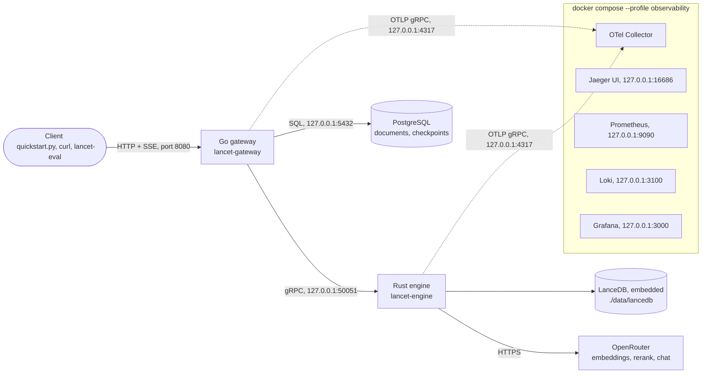
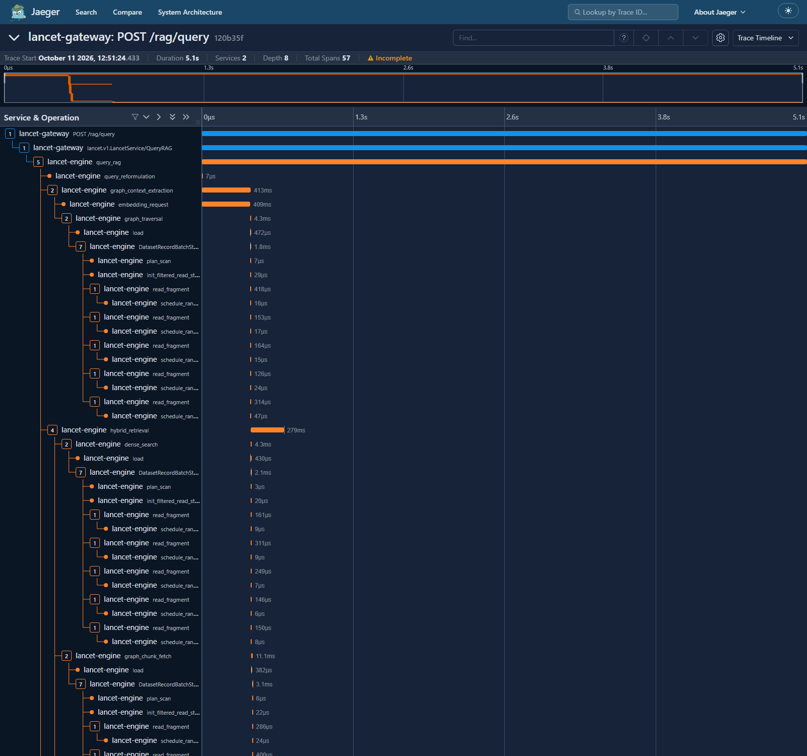
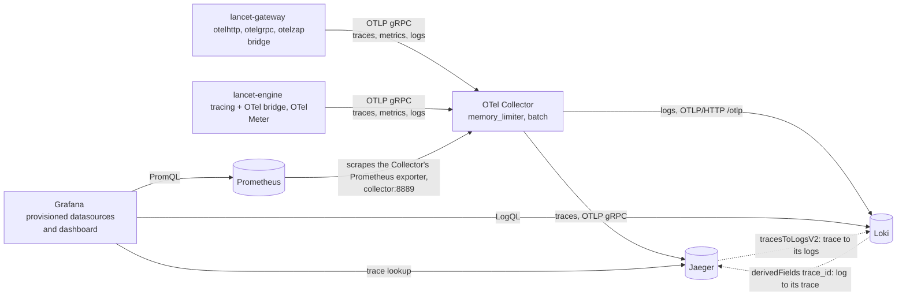

# Observability Walkthrough: One Question, Two Traces

> [!NOTE]
> Every capture on this page comes from the verified quickstart's fresh sample store. That is the Windows native
> fresh-clone run of plan 06.4-09 on the shipped defaults; its transcript is
> [`06.4-QS-TRANSCRIPT-WINDOWS.md`](../.planning/phases/06.4-docs-suite-verified-quickstart-debt-backlog-promotion-and-v1/06.4-QS-TRANSCRIPT-WINDOWS.md).
> The span tables are read from the committed Jaeger exports
> ([`jaeger-default-query.trace.json`](assets/jaeger-default-query.trace.json),
> [`jaeger-graph-optin.trace.json`](assets/jaeger-graph-optin.trace.json)), not from the screenshots, and
> `eval/tests/test_observability_doc.py` re-reads every row against them. Each table shows what one request took on
> one machine. It is not a latency benchmark: latency and quality across many questions are on the results page,
> [`docs/evaluation.md`](evaluation.md).

## Summary

1. **One question, asked twice.** The same two-entity question from the [quickstart](../README.md#-quickstart-windows-native-and-linux-via-wsl)
   runs once on the shipped default shape (hybrid retrieval, `rerank` and `evidence_metadata`, graph off) and once with
   the graph opted in. Both requests leave one trace each, and the two traces differ in structure only where the
   graph runs.
2. **One trace crosses both services.** The caller's W3C `traceparent` reaches the gateway. The gateway's root span
   covers the whole SSE stream, the trace crosses the gRPC hop into the engine, and the engine shows its five workflow
   nodes, each with a child span per external call.
3. **Generation is most of the wait.** In both traces `llm_generation` dominates. The query embedding and the
   `rerank_request` call come next. The local LanceDB and BM25 searches barely register.
4. **The graph is visible when it runs and accounted for when it does not.** By default `graph_context_extraction`
   returns early and the response carries the `GRAPH_DISABLED_BY_CONFIG` notice. With the graph opted in, a
   `graph_traversal` leaf finds a path between the question's two entities, and a `graph_chunk_fetch` leaf pulls that
   path's source chunks into retrieval.
5. **Metrics and logs answer what one trace cannot.** The provisioned Grafana dashboard tracks rates, tails and index
   state across every request. Logs from both services land in Loki, joined to their trace by `trace_id`.
6. **Sampling is always on, and it can be overridden.** Both services sample every trace by default and read one ratio
   key each from TOML or the environment. The production reasoning for ratio sampling is in [Sampling](#sampling).

## Where the services run

Diagram 1 shows the system and deployment topology the captures came from.

The values on the diagram are the committed configuration:
- from `config/config.toml`: `[gateway] port`, `[engine] grpc_addr` and `lancedb_path`, and the `otlp_endpoint` key in
  both `[gateway.telemetry]` and `[engine.telemetry]`;
- from `docker-compose.yml`: the published host ports.

PostgreSQL (`db`) is the only service with no compose profile, so a plain `docker compose up -d` starts only it. The
Collector, Jaeger, Prometheus, Loki and Grafana start with `--profile observability` (06-CONTEXT D-39). If the
Collector is not running, both services degrade to stdout logging and keep serving (D-38).

## The default request

The question, as sent by `quickstart.py query` without `--graph`:

> Which company built the spectrograph at Harbor Light Observatory, which Marisol Vega directs, and where is that
> company based?

The request names no lever and leaves `disable_graph_context` absent, so the engine applies the configured defaults in
`config/config.toml`:
- `[engine.levers] defaults = ["rerank", "evidence_metadata"]`;
- `[engine.graph] context_default_enabled = false` (06.4 D-207).

The shipped default request is therefore hybrid retrieval plus `rerank` plus `evidence_metadata`, with the graph off.
The evidence record for this run (`06.4-QS-EVIDENCE-WINDOWS.json`, query `two_hop_default`) echoes the levers
`rerank` and `evidence_metadata` and the single notice `GRAPH_DISABLED_BY_CONFIG`.

*Jaeger, default request (trace `6b986b3d9efc5d266429bcba3409c3bd`).*

**Why Jaeger says "Incomplete".** `quickstart.py` makes up a trace id and a span id and sends them as a W3C
`traceparent` header with the sampled flag set (06-CONTEXT D-28). The gateway honours it, so the trace id the script
prints is the one Jaeger shows. The script runs no OpenTelemetry SDK, though, so the client span the header names is
never exported. The gateway's root span points at a parent Jaeger never received, and Jaeger flags the trace. This is
expected, and it is the same for any client that propagates context without exporting its own spans.

### Following the request through the spans

1. **The gateway root span, `POST /rag/query`.** The gateway's `otelhttp` handler opens it on request and closes it
   when the SSE stream ends, so its duration is the latency the user waited (D-31). Before it closes, the gateway sets
   the terminal outcome on it: `lancet.answer_basis`, `lancet.degraded_mode`, `lancet.notice_codes` and
   `lancet.stream_terminal_seen`. The notice the graph node raised is read here, on the root, not on the node span. The
   span also keeps `lancet.correlation_id`, which ties the trace to the response, the notices and the checkpoints
   (D-27).
2. **The gRPC hop, `lancet.v1.LancetService/QueryRAG`.** This is the gateway's `otelgrpc` client span. It carries the
   trace context in gRPC metadata into the engine (D-37). It also lasts as long as the stream.
3. **The engine's request span, `query_rag`.** It is the engine-side parent of the five workflow nodes. Its
   `lancet.workflow.*` attributes are the same workflow metadata the wire's `WorkflowCompletedEvent` carries (D-41):
   candidate counts per path, the graph's seed and path readings, and the token counts.
4. **`query_reformulation`.** Reformulation produced one variant, the original question, and made no model call.
5. **`graph_context_extraction`, returning early.** This node runs before retrieval because it holds the query-embedding
   prelude. The vector it computes is read by both the dense search and graph seeding
   (`engine/src/workflow/nodes/graph_context.rs`). Its `embedding_request` child is that one embedding call. With the
   graph off, the node then returns at once and adds `GRAPH_DISABLED_BY_CONFIG`. So in the default trace, the graph
   node's time is the query embedding's time, not graph work.
6. **`hybrid_retrieval`.** Its leaves are:
   - `dense_search` (LanceDB vector search);
   - `bm25_search` (the in-memory BM25 index);
   - `rerank_request`, the leaf span added for the rerank provider call (06.4 D-227). Its `lancet.rerank.outcome` and
     `lancet.rerank.latency_ms` say whether the rerank lever ran and how long the provider took.

   Once a provider call has started, a rerank that times out or fails still records its outcome on this span.
7. **`prompt_assembly`.** It packs the evidence blocks into the prompt; `lancet.prompt.evidence_block_count` says how
   many.
8. **`llm_generation` and `llm_attempt`.** One `llm_attempt` child per model call, so a generation retry would show as
   two sibling attempts (D-29). `gen_ai.request.model` and `gen_ai.usage.*` follow the OpenTelemetry GenAI conventions
   (D-42).

The trace also carries LanceDB's own internal spans (`load`, `DatasetRecordBatchStream`, `plan_scan`,
`init_filtered_read_stream`, `read_fragment`, `schedule_ranges`) under each LanceDB call; the tables below leave them
out. Each duration is the first span of that name by start time, in milliseconds, rounded half up to one decimal from
the export's microseconds.

<!-- span-table:default:start -->
| span | parent | duration (ms) | key attributes |
|---|---|---|---|
| `POST /rag/query` | client span (not exported) | 4665.6 | `http.response.status_code` = `200`, `lancet.answer_basis` = `retrieval`, `lancet.degraded_mode` = `false`, `lancet.notice_codes` = `["GRAPH_DISABLED_BY_CONFIG"]`, `lancet.stream_terminal_seen` = `true` |
| `lancet.v1.LancetService/QueryRAG` | `POST /rag/query` | 4665.6 | `rpc.system.name` = `grpc`, `server.port` = `50051`, `rpc.response.status_code` = `OK` |
| `query_rag` | `lancet.v1.LancetService/QueryRAG` | 4664.7 | `lancet.workflow.vector_count` = `13`, `lancet.workflow.bm25_count` = `11`, `lancet.workflow.graph_seed_count` = `0`, `lancet.workflow.graph_path_found` = `false`, `lancet.workflow.prompt_tokens` = `2560`, `lancet.workflow.completion_tokens` = `128` |
| `query_reformulation` | `query_rag` | 0.0 | `lancet.node.outcome` = `ok`, `lancet.reformulation.variant_count` = `1` |
| `graph_context_extraction` | `query_rag` | 371.2 | `lancet.node.outcome` = `ok`, `lancet.graph.node_count` = `0`, `lancet.graph.edge_count` = `0` |
| `embedding_request` | `graph_context_extraction` | 371.1 | `gen_ai.request.model` = `voyageai/voyage-4-large` |
| `hybrid_retrieval` | `query_rag` | 261.2 | `lancet.node.outcome` = `ok`, `lancet.retrieval.dense_count` = `13`, `lancet.retrieval.bm25_count` = `11` |
| `dense_search` | `hybrid_retrieval` | 5.1 | `db.system` = `lancedb`, `db.operation` = `vector_search`, `lancet.index.generation` = `lance-11` |
| `bm25_search` | `hybrid_retrieval` | 0.0 | `lancet.retrieval.path` = `bm25`, `lancet.index.generation` = `bm25-memory` |
| `rerank_request` | `hybrid_retrieval` | 256.0 | `gen_ai.request.model` = `voyageai/rerank-2.5-lite`, `lancet.rerank.candidates` = `13`, `lancet.rerank.outcome` = `completed`, `lancet.rerank.latency_ms` = `256` |
| `prompt_assembly` | `query_rag` | 1.6 | `lancet.node.outcome` = `ok`, `lancet.prompt.evidence_block_count` = `8` |
| `llm_generation` | `query_rag` | 4030.4 | `lancet.node.outcome` = `ok`, `lancet.generation.attempts` = `1` |
| `llm_attempt` | `llm_generation` | 4030.3 | `gen_ai.request.model` = `deepseek/deepseek-v4-flash-0731`, `gen_ai.usage.input_tokens` = `2560`, `gen_ai.usage.output_tokens` = `128`, `lancet.attempt.outcome` = `ok` |
<!-- span-table:default:end -->

### Where the time went

Read the table top-down.
- **Service overhead is small.** The gateway root, the gRPC hop and `query_rag` are almost equal, so the gateway and
  the hop between the two services add little.
- **Generation.** Inside the engine, `llm_generation` is most of the request: one model call, one attempt.
- **Two network calls of similar size.** The next largest items are `embedding_request` (inside the graph node, for the
  reason given above) and `rerank_request`. The rerank call is nearly all of `hybrid_retrieval`.
- **Local work.** `dense_search` and `bm25_search` are local, and they are small next to the provider calls. So are
  `prompt_assembly` and `query_reformulation`.

The rerank lever's latency cost is a provider round-trip. That is where to look when the rerank latency caveat on the
results page matters.

## The same question, graph opted in (opt-in)

The second request is the same question with `--graph`, which sends `"disable_graph_context": false`. That is how any
client turns the graph on for one request (06.4 D-207, D-216). An absent field means the configured default, which
ships off; `false` means on; `true` means off on purpose and carries the `GRAPH_ABLATION` notice instead. The graph is
a fully built and observable subsystem that ships opt-in, because on the MultiHop-RAG measurement it cost latency and
prompt tokens and bought no significant gain. That cost and the measured value are on the results page,
[`docs/evaluation.md`](evaluation.md), not here.

*Jaeger, graph opted in (trace `120b35f5a25518b66de6f05b6ea1367d`). The "Incomplete" banner has the same cause as
above.*

What changes against the default trace:
- **`graph_context_extraction` does graph work.** After the same query-embedding prelude it opens a `graph_traversal`
  leaf. That leaf is the Cypher-style traversal against the `entities` and `entity_edges` tables:
  - it matches the question's named entities to seeds (`lancet.graph.seed_count`);
  - it searches for a bounded path between them (`lancet.graph.path_found`);
  - it reports the subgraph it kept (`lancet.graph.node_count`, `lancet.graph.edge_count`).

  The request-level reading is `lancet.workflow.graph_path_found` on `query_rag`. It is what the quickstart prints as
  `graph_path_found`, and it is why the question names two entities: a path needs two seeds.
- **Retrieval gains a third list.** `hybrid_retrieval` now has a `graph_chunk_fetch` leaf. It fetches the source chunks
  of the entities on the path, by id, so they can be fused with the dense and BM25 lists.
- **The prompt grows.** The path facts go into the prompt (`lancet.workflow.graph_prompt_fact_count`), which is why the
  opt-in request's `gen_ai.usage.input_tokens` is larger than the default request's.
- **No notice.** The root's `lancet.notice_codes` is empty, because the graph ran and found a path.

The traversal and the chunk fetch are small next to the provider calls in this trace. The two generation times differ
too, but two single requests say nothing about what the graph costs systematically; the results page has the measured
readings. The opt-in trace also carries more LanceDB internal spans, because the traversal and the chunk fetch each read
the store.

<!-- span-table:optin:start -->
| span | parent | duration (ms) | key attributes |
|---|---|---|---|
| `POST /rag/query` | client span (not exported) | 5124.6 | `http.response.status_code` = `200`, `lancet.answer_basis` = `retrieval`, `lancet.degraded_mode` = `false`, `lancet.notice_codes` = `[]`, `lancet.stream_terminal_seen` = `true` |
| `lancet.v1.LancetService/QueryRAG` | `POST /rag/query` | 5124.1 | `rpc.system.name` = `grpc`, `server.port` = `50051`, `rpc.response.status_code` = `OK` |
| `query_rag` | `lancet.v1.LancetService/QueryRAG` | 5123.4 | `lancet.workflow.vector_count` = `13`, `lancet.workflow.bm25_count` = `11`, `lancet.workflow.graph_seed_count` = `2`, `lancet.workflow.graph_path_found` = `true`, `lancet.workflow.graph_prompt_fact_count` = `2`, `lancet.workflow.prompt_tokens` = `2740`, `lancet.workflow.completion_tokens` = `113` |
| `query_reformulation` | `query_rag` | 0.0 | `lancet.node.outcome` = `ok`, `lancet.reformulation.variant_count` = `1` |
| `graph_context_extraction` | `query_rag` | 413.3 | `lancet.node.outcome` = `ok`, `lancet.graph.node_count` = `3`, `lancet.graph.edge_count` = `3` |
| `embedding_request` | `graph_context_extraction` | 409.0 | `gen_ai.request.model` = `voyageai/voyage-4-large` |
| `graph_traversal` | `graph_context_extraction` | 4.3 | `graph_augmentation` = `succeeded`, `lancet.graph.seed_count` = `2`, `lancet.graph.path_found` = `true`, `lancet.graph.node_count` = `3`, `lancet.graph.edge_count` = `3` |
| `hybrid_retrieval` | `query_rag` | 279.5 | `lancet.node.outcome` = `ok`, `lancet.retrieval.dense_count` = `13`, `lancet.retrieval.bm25_count` = `11` |
| `dense_search` | `hybrid_retrieval` | 4.3 | `db.system` = `lancedb`, `db.operation` = `vector_search`, `lancet.index.generation` = `lance-11` |
| `graph_chunk_fetch` | `hybrid_retrieval` | 11.1 | `db.system` = `lancedb`, `db.operation` = `select`, `lancet.index.generation` = `lance-11` |
| `bm25_search` | `hybrid_retrieval` | 0.0 | `lancet.retrieval.path` = `bm25`, `lancet.index.generation` = `bm25-memory` |
| `rerank_request` | `hybrid_retrieval` | 263.9 | `gen_ai.request.model` = `voyageai/rerank-2.5-lite`, `lancet.rerank.candidates` = `13`, `lancet.rerank.outcome` = `completed`, `lancet.rerank.latency_ms` = `263` |
| `prompt_assembly` | `query_rag` | 1.9 | `lancet.node.outcome` = `ok`, `lancet.prompt.evidence_block_count` = `8` |
| `llm_generation` | `query_rag` | 4428.3 | `lancet.node.outcome` = `ok`, `lancet.generation.attempts` = `1` |
| `llm_attempt` | `llm_generation` | 4428.3 | `gen_ai.request.model` = `deepseek/deepseek-v4-flash-0731`, `gen_ai.usage.input_tokens` = `2740`, `gen_ai.usage.output_tokens` = `113`, `lancet.attempt.outcome` = `ok` |
<!-- span-table:optin:end -->

## Where the telemetry goes

Diagram 4 is the telemetry topology (06-CONTEXT D-34, D-36, D-37).

The values on the diagram are the committed configuration:
- `deploy/collector/otel-collector-config.yaml`: the receivers, processors and exporters;
- `deploy/prometheus/prometheus.yml`: the scrape target;
- `deploy/grafana/provisioning/datasources/datasources.yaml`: the two Grafana links.

Both services send all three signals to the one Collector, which has no state of its own worth reading. Prometheus pulls
metrics from the Collector's exporter; it is not pushed to. Everything in Grafana is provisioned from committed files,
with no manual UI state (D-40).

## Metrics: what a single trace cannot tell you

A trace is one request. The engine's metrics (`engine/src/telemetry/metrics.rs`) count every request, so they answer
questions about rates, tails and the index's life over time (06-CONTEXT D-35). Each instrument maps to a decision made
in Phase 6. The provisioned dashboard, "Lancet RAG Operations"
(`deploy/grafana/dashboards/lancet-rag-operations.json`, generated from the typed source in
`deploy/grafana/dashboard_gen/`), has one panel per instrument.

The Prometheus series names are not the instrument names. The Collector's Prometheus exporter turns the dots into
underscores, appends `_total` to counters, and inserts the unit `_milliseconds` into the millisecond histograms, with no
namespace prefix. That rule was read off a live scrape (`06.2-03-SUMMARY.md`), not predicted.

| instrument (`metrics.rs`) | series the dashboard queries | attributes | what it answers that one trace cannot |
|---|---|---|---|
| `lancet.rag.query.duration` | `lancet_rag_query_duration_milliseconds_bucket` | `outcome` (`completed`, `failed`) | The latency distribution and its tail across all requests; the panel plots `histogram_quantile(0.95, …)` per outcome. One trace is one sample. |
| `lancet.rag.retrieval.path_failures` | `lancet_rag_retrieval_path_failures_total` | `path` (`dense`, `bm25`, `graph`, `rerank`), `kind` (`timeout`, `error`, `unavailable`) | How often each retrieval path degrades, and why, over time. A trace shows only whether this request degraded. |
| `lancet.rag.answer.degraded` | `lancet_rag_answer_degraded_total` | `answer_basis` (`mixed`, `model_only`) | The share of answers not grounded only in retrieval. |
| `lancet.rag.citation.repairs` | `lancet_rag_citation_repairs_total` | `action` (`repaired`, `dropped`) | How often the model's citation markers have to be repaired or dropped: a quality-drift signal. |
| `lancet.rag.generation.retries` | `lancet_rag_generation_retries_total` | `outcome` (`recovered`, `exhausted`) | Whether the generation provider is getting less reliable, and whether retries still save the answer. |
| `lancet.rag.evidence.set_size` | `lancet_rag_evidence_set_size_bucket` | none | How much evidence a prompt typically carries. |
| `lancet.ingest.documents` | `lancet_ingest_documents_total` | `outcome` (`completed`, `failed`) | Ingestion throughput and failure rate. |
| `lancet.ingest.chunks` | `lancet_ingest_chunks_total` | none | Chunk throughput, which is what embedding and extraction cost scales with. |
| `lancet.index.rebuild.duration` | `lancet_index_rebuild_duration_milliseconds_bucket` | `outcome` (`completed`, `failed`) | How long rebuild-and-swap takes, and whether it fails. |
| `lancet.index.corpus_generation` | `lancet_index_corpus_generation` | none | Which index generation is live and when it moved. A query trace shows only the generation it read (`lancet.index.generation` on `dense_search`). |

**`lancet.rag.answer.degraded` is narrower than `degraded_mode`.** The counter records only answers whose
`answer_basis` is not `retrieval`. The wire's `degraded_mode` flag (and `lancet.degraded_mode` on the root span) also
fires when certain degrade notices are present on an answer whose basis is still `retrieval`. The two are not
interchangeable; the predicate is documented at the top of `metrics.rs` (`06.2-05` plan).

*Grafana, captured right after the quickstart's handful of requests.* Several panels read "No data": retrieval path
failures, answer degraded rate, citation repairs and generation retries. That is expected rather than broken. Those
counters only record when their event happens, and Prometheus held no series for them when the capture was taken. With so
few requests, the latency and rate panels are a handful of points, not a distribution.

## Logs: joined to traces by `trace_id`

Both services write structured logs to Loki through OTLP:
- the gateway uses zap with the `otelzap` bridge;
- the engine uses `tracing` events with the OpenTelemetry appender (D-36).

A log written inside a request carries that request's `trace_id`, and Grafana links the two both ways
(`deploy/grafana/provisioning/datasources/datasources.yaml`, D-34):
- **From a trace to its logs.** The Jaeger datasource's `tracesToLogsV2` setting opens the Loki records filtered by the
  trace's id.
- **From a log to its trace.** The Loki datasource's derived field on `trace_id` opens the trace in Jaeger.

Not every log is a request's log. The gateway classifies its log sites, and the classification is deliberate
(`06.2-06-SUMMARY.md`):
- **Request-owned logs carry trace context.** Examples are `insert document`, `rag query stream opened` and
  `retain pending checkpoint failed`.
- **Background logs do not.** Examples are the compensation of a failed ingestion, the reconciler, and server
  lifecycle. They keep their plain string attributes (such as `document_id`) so a human can still join by hand.

A background log stamped with an invented trace id would be worse than an uncorrelated one, because Grafana's link would
then open a trace that belongs to no request.

Ingestion is traced too (D-30), one trace per document: admission at the engine, then chunking, embedding, the staging
write and graph extraction, each extraction attempt its own span. The index rebuild is a separate span with links back
to every document that triggered it. This page does not walk an ingestion trace; the quickstart's ingest step leaves
them in Jaeger next to the query traces.

## Sampling

**Shipped behaviour: always on, overridable** (06-CONTEXT D-32). Each service reads one ratio. The committed value is
`sampler_ratio = 1.0` under both `[gateway.telemetry]` and `[engine.telemetry]` in `config/config.toml`. Two
environment variables override them, following the TOML+env convention:
- `LANCET_GATEWAY__TELEMETRY__SAMPLER_RATIO`;
- `LANCET_ENGINE__TELEMETRY__SAMPLER_RATIO`.

An environment override outside `0.0..=1.0`, or one that is not a number, fails startup on either service with an
error naming the variable (`gateway/internal/config/config.go`, `engine/src/config.rs`). The gateway also rejects an
out-of-range TOML value. The engine checks only the override: from TOML it treats a value at or above the top of the
range as always-on and one at or below the bottom as always-off (`engine/src/telemetry/mod.rs`).

What a ratio below one does differs by service:
- **Gateway.** It uses `ParentBased(TraceIDRatioBased(ratio))` (`gateway/internal/telemetry/telemetry.go`). An inbound
  `traceparent` decides for the request, which is why the quickstart's sampled flag is always honoured. Only a request
  that arrives without one is sampled by ratio.
- **Engine.** It uses a plain `TraceIdRatioBased(ratio)`, not parent-based, wrapped in `GraphSpanRetainingSampler`
  (`engine/src/telemetry/mod.rs`). The wrapper always keeps `graph_traversal` and `graph_context_extraction`, so a
  graph investigation keeps its spans even when the rest of the trace is dropped. Those spans can then arrive without
  their root, which the code records as an accepted cost.
- **At the shipped ratio,** both samplers keep everything, and the wrapper changes nothing.

### Why ratio sampling in production

Always-on is right here. This is a local system with one user, so every trace costs nothing worth saving, and every
trace is evidence when a run or a quickstart step goes wrong. At production volume the reasoning changes.

- **Cost and volume.** Span count grows with traffic, and with corpus work: an ingestion trace grows with the
  document's chunk count, and every LanceDB call adds the store's own internal spans. Every span is paid for several
  times:
  - in the services, which build and export it;
  - in the Collector, which receives it;
  - in Jaeger's storage;
  - in whoever pages through it.

  Most of those traces would be identical successful requests. Keeping a fixed fraction keeps the shape of normal
  traffic at a fraction of the cost.
- **Head sampling is what is built.** The decision is made when the trace starts, from the trace id, so it is cheap,
  needs no buffering, and every service that honours the parent agrees on it. Its weakness is that it is blind to the
  outcome. It drops the rare failed or slow request at the same rate as the boring ones, and those are the traces worth
  keeping.
- **Tail sampling is the production direction, and it is not configured here.** The Collector pipeline in
  `deploy/collector/otel-collector-config.yaml` runs only `memory_limiter` and `batch`. A tail-sampling Collector
  buffers each trace until it completes, then decides with the outcome in hand. It keeps every trace whose root
  carries an error status, `lancet.degraded_mode` = `true` or a degrade notice in `lancet.notice_codes`. It keeps every
  trace slower than a latency threshold. It samples the rest at a ratio. The cost is memory for the buffer and routing
  that sends all of a trace's spans to the same Collector instance.
- **Metrics do not depend on trace sampling.** The counters and histograms above count every request whatever the
  sampler drops, so rates and tails stay exact. That is one reason rates belong in metrics, not in trace counts.
- **Two cautions for whoever lowers the ratio.**
  - The engine does not follow the gateway's decision. Unequal ratios, or a caller's `traceparent` that makes the
    gateway sample a request its own ratio would have dropped, can produce traces with only one service's half. Keep
    the ratios equal, and make the engine parent-based before relying on caller-driven sampling.
  - A request-owned log keeps its `trace_id` even when the trace was dropped, so its Grafana link can lead to a trace
    that was never stored.

## Related pages

- The [quickstart](../README.md#-quickstart-windows-native-and-linux-via-wsl): how to reproduce both traces and open
  them in Jaeger and Grafana.
- The results page, [`docs/evaluation.md`](evaluation.md): the measured cost and value of the graph and of the rerank
  and metadata levers, and the latency readings across runs.
- The API contract, [`docs/api-contract.md`](api-contract.md): the request fields used here
  (`disable_graph_context`, the lever fields) and every notice code, including `GRAPH_DISABLED_BY_CONFIG` and
  `GRAPH_ABLATION`.
- The operational note on evaluation fidelity, [`evaluation-fidelity-and-graph-yield.md`](evaluation-fidelity-and-graph-yield.md).
